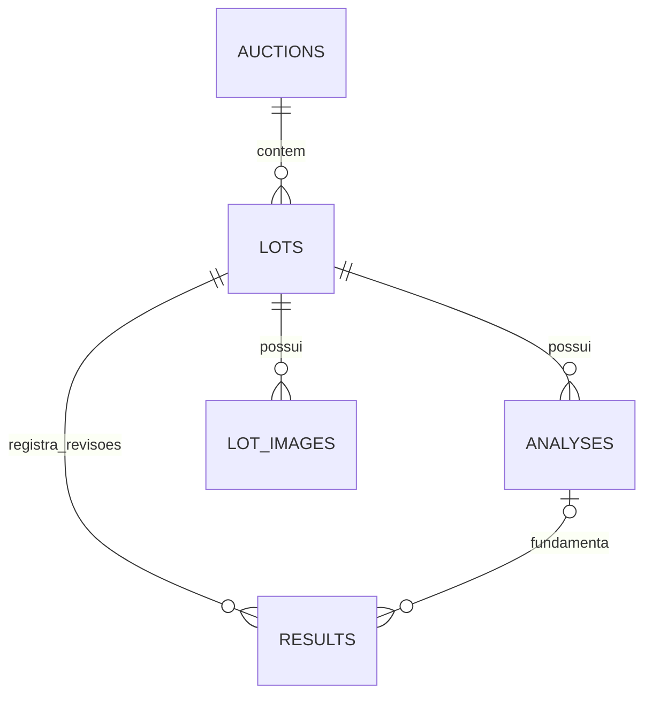

# Leilão Tracker — Especificação do projeto

> Versão: 1.0 • Data: 20/09/2026 • Status: proposta para orientar a implementação.
>
> Documento baseado no contexto fornecido pelo usuário. Esta entrega define o projeto; não implementa a aplicação.

## 1. Visão do produto

O **Leilão Tracker** será uma aplicação web privada para estudar e acompanhar leilões de veículos, calcular um limite de lance e registrar os resultados observados.

A pergunta central do produto é:

**“Considerando minhas estimativas de valor, custos e margem, quanto posso pagar por este lote?”**

Seu principal ativo será o histórico das análises feitas **antes de conhecer o resultado**. Cada lote reunirá informações do veículo, referências de preço, custos previstos, limite de lance, justificativas e resultado do leilão. Com o uso, essa base permitirá comparar expectativas com dados observados e melhorar os critérios de decisão.

O uso inicial será predominantemente em **modo observador**: analisar e acompanhar sem precisar participar de um leilão ou comprar um veículo.

## 2. Público, objetivos e premissas

### Público inicial

Uma pessoa que deseja aprender sobre leilões de veículos, organizar suas observações e testar critérios financeiros antes de comprometer capital.

### Objetivos do MVP

1. Centralizar leilões e lotes acompanhados.
2. Padronizar a análise de custos e o cálculo do lance máximo.
3. Preservar o raciocínio e as estimativas anteriores ao resultado.
4. Registrar o preço final e identificar se ficou dentro do limite definido.
5. Formar uma base inicial de aproximadamente 50 a 100 lotes analisados.

### Premissas adotadas nesta especificação

- Uso individual e privado, com interface em português do Brasil.
- Aplicação web responsiva, priorizando a experiência em desktop.
- Valores em reais, com datas exibidas no fuso `America/Sao_Paulo`.
- Cadastro e atualização dos dados feitos manualmente.
- A aplicação não envia lances nem executa compras.
- FIPE, preço de mercado, danos e situação documental são informações fornecidas pelo usuário; não haverá verificação automática no MVP.
- Um único proprietário usará a aplicação. Login protege o acesso, sem cadastro público, equipes, convites ou gestão de usuários.
- A stack proposta no contexto será mantida, com um único projeto Next.js.

Essas premissas permitem iniciar a implementação sem depender de decisões de infraestrutura ou integrações externas além do banco, autenticação e armazenamento previstos.

## 3. Escopo

### MVP: diário de leilões com calculadora

| Área | Entrega |
| --- | --- |
| Leilões | Cadastrar, listar, consultar, editar e arquivar leilões. |
| Lotes | Cadastrar veículos dentro de um leilão, adicionar fotos, acompanhar e registrar observações. |
| Análise financeira | Informar referências de preço, estimar custos, calcular limite e preservar versões fixadas da análise. |
| Resultado | Registrar desfecho e preço final, vinculando a análise anterior usada na comparação. |
| Dashboard básico | Mostrar contagens, próximos leilões e lotes acompanhados com a situação em relação ao limite. |
| Acesso e persistência | Login privado, banco de dados persistente e armazenamento privado de fotos. |

O dashboard do MVP será uma visão operacional simples. Gráficos, padrões de mercado e estatísticas detalhadas pertencem à próxima fase.

### Fora do MVP

- Scraping, crawlers e atualização automática de lances.
- Importação CSV/Excel, extração de PDFs e OCR de editais.
- Integração automática com FIPE, consultas de veículos ou plataformas de leilão.
- IA para avaliar fotos, veículos ou documentos.
- Previsão de preço, recomendações e score de compra.
- Alertas por e-mail, push ou mensageria.
- Backtesting avançado e simulação de carteira.
- Controle detalhado de recuperação, revenda e lucro realizado.
- Estatísticas de precisão das estimativas e comparação avançada entre modelos.
- Marketplace, pagamentos, assinatura e aplicativo mobile nativo.
- Equipes, compartilhamento de base e múltiplos usuários de negócio.
- Backend separado, filas e workers.

## 4. Fluxo principal

1. O usuário acessa a aplicação com sua conta.
2. Cadastra um leilão com data, organizador e links de referência.
3. Adiciona um lote, informa os dados conhecidos e marca se deseja acompanhá-lo.
4. Abre a análise financeira e preenche valor de mercado, custos e margem desejada.
5. Experimenta valores de lance e vê o impacto no custo total e na margem estimada.
6. Salva um rascunho ou **fixa a análise**, preservando suas premissas e o limite calculado.
7. Atualiza manualmente o lance atual enquanto acompanha o lote.
8. Após o encerramento, registra o desfecho e, quando conhecido, o preço final.
9. O sistema compara o resultado com a análise fixada antes do desfecho.
10. O usuário consulta seu histórico, incluindo os motivos para não participar ou ultrapassar seu limite em uma compra real.

Também será possível cadastrar um lote já encerrado. Nesse caso, a aplicação identificará uma análise feita depois do resultado como **retrospectiva** e a separará das métricas sobre decisões anteriores ao desfecho.

## 5. Telas e navegação

### `/login` — Acesso

- Login com a conta previamente autorizada.
- Mensagens claras para credenciais inválidas e sessão expirada.
- Sem inscrição pública no MVP.
- Após autenticação, redirecionamento ao dashboard.

### `/dashboard` — Visão geral

A home responde, nesta ordem: o que vale analisar agora, se os lotes acompanhados ainda cabem no limite, o que está pendente e se as decisões têm acertado. Plano e medição em `docs/PLANO-DASHBOARD.md` (D-44).

Cabeçalho, numa linha de contagens que levam à ação:

- **Para analisar:** quantos anúncios estão no bloco "Para analisar agora".
- **Próximo leilão na região:** data e lotes no filtro padrão.
- **Acompanhados:** lotes ativos marcados e ainda sem resultado, e quantos têm preço provável acima do limite fixado.
- **Pendências:** rascunhos e resultados a registrar ou confirmar.

A ação principal é **Ver leilões**; **Novo leilão** é secundária.

Conteúdo principal:

- **Para analisar agora:** até 6 anúncios abertos no filtro padrão do catálogo (até 150 km da região; carros, motos e utilitários) ou em algum monitor ligado, ainda não adicionados à análise nem dispensados, cujo preço provável cabe no limite. **Dispensar** tira a sugestão só para o usuário, com desfazer.
  - **Cabe com folga:** P75 do provável ≤ limite.
  - **No limite:** mediana ≤ limite < P75.
  - **Ordem:** provável por vendas comparáveis antes do provável pela proporção, folga antes de "no limite" e, depois, encerra primeiro.
  - **Limite:** o estimado pelas análises do usuário, quando há 3 parecidas; senão, o das premissas padrão do anúncio (§7, D-38), rotulado como tal.
- **Lotes acompanhados:** ordenados pelo fim do anúncio, com veículo, leilão, lance atual, limite fixado, situação do lance (abaixo, no limite, acima ou sem dados suficientes) e preço provável frente ao limite.
- **Próximos leilões na região:** leilões do catálogo nos próximos 7 dias com lote no filtro padrão ou em algum monitor, com data, fonte, lotes no filtro e quantos cabem no limite. Os leilões cadastrados pelo usuário ficam em "Minhas análises".
- **Lateral:** registros pendentes, o indicador de decisões e a situação da coleta.

O indicador **“X de Y resultados comparáveis ficaram dentro do limite”** continua visível. As regras de elegibilidade estão na seção 10.

O bloco "Para analisar agora" compara o **preço provável** com o limite, nunca o lance atual com o histórico: dois dias antes do fim, o lance ainda está, na mediana, em 90% do final. Estimativas não fixam análise, mostram a base (`n`, método e confiança) e não viram score, lucro ou economia.

O **preço provável** de um anúncio é a mediana dos lances finais de vendas do mesmo modelo base, ano ±1, mesma condição declarada e quilometragem próxima, encerradas no último ano; sem 5 delas, a proporção lance ÷ valor de mercado das vendas da mesma categoria e condição. A faixa mostrada é onde cai **metade das próximas vendas** (alargada quando há poucas). A **confiança** é alta com 20 vendas ou mais e faixa estreita, média com faixa aceitável e baixa no resto, incluindo toda estimativa pela proporção. Os números do backtest que fixaram essas regras estão em [docs/PLANO-MERCADO.md](docs/PLANO-MERCADO.md) §2.

Não haverá card de lucro realizado ou economia garantida baseado em simulações.

A navegação separa o **leilão do catálogo** (o evento, com todos os lotes coletados) do **registro do usuário** (o leilão com os lotes que ele analisou). Plano e motivo em `docs/PLANO-NAVEGACAO.md` (D-42).

### `/leiloes` — Leilões do catálogo

- Leilões coletados automaticamente, um cartão por leilão: fonte, nome, data, total de lotes, abertos, lotes no filtro e lotes já analisados pelo usuário.
- Filtros dos anúncios (ver **Filtros de Leilões** abaixo); só aparece leilão com lote no filtro.
- Seletor abertos/encerrados, ordenado pela data.
- Alternância para **Todos os veículos** (`/leiloes/veiculos`): os anúncios sem agrupar, com ordem (encerra antes, menor lance, menor % do mercado, mais perto, mais novos).

#### Filtros de Leilões

Plano e decisões em `docs/PLANO-FILTROS.md` (D-43).

- Cada escolha aplica na hora e vai para a URL; o total de lotes aparece ao lado e cada filtro ativo vira um chip removível, com "Limpar tudo".
- Busca por marca, modelo ou versão, com sugestões de marca e modelo e a contagem de cada uma.
- Preço (faixa do lance atual ou, sem lance, do mínimo) e teto em % do valor de mercado; ano do modelo (grade de anos e atalhos "Até 5/10 anos"); distância de São Carlos/SP.
- Mais filtros: categoria, combustível, quilometragem, condição declarada (escala e itens a esconder: circulação vedada, chassi remarcado, airbag acionado, laudo reprovado), só com chave, origem (financeira, seguradora, frota, órgão público), site do leilão, encerra em, lances, novos e já analisados. Categorias, sites, origens e combustíveis mostram quantos lotes cada opção traria.
- Atalhos de um toque (ex.: "Até 60% do mercado", "Sem monta", "Encerra em 48 h").
- "Salvar como monitor" abre o novo monitor com os mesmos critérios.

### `/leiloes/[fonte]/[leilao]` — Leilão do catálogo

- Os anúncios do leilão, com filtros, indicando os que o usuário já analisou.
- Acesso ao registro do usuário desse leilão, quando existir.

### `/minhas-analises` — Minhas análises

- Os lotes do usuário. Padrão: **todos os lotes**, paginados; opção **por leilão**, com os mesmos filtros.
- Busca por número, marca ou modelo; filtros por lance × limite (abaixo, no limite, acima, sem lance viável, sem comparação), leilão próximo ou realizado, acompanhamento, presença de análise e resultado; visualização opcional de arquivados. Aplicam na hora, com chips e total.
- Ordem: data do leilão, maior folga até o limite ou atualizados recentemente.
- Botão para cadastrar leilão manualmente.

### `/minhas-analises/leiloes/[id]` — Leilão do usuário

- Dados do evento e links para edital e plataforma.
- Lista paginada de seus lotes, com busca e os mesmos filtros.
- Ações para editar o leilão, adicionar lote, arquivar e abrir uma análise.
- Quando o leilão veio do catálogo, acesso a todos os lotes dele.

### `/lotes/[id]` — Ficha do lote

- Identificação do lote e dados do veículo.
- Galeria de fotos, link de origem e observações.
- Lance inicial, lance atual e quando este foi atualizado.
- Referências manuais de FIPE e valor de mercado, acessíveis pela análise.
- Resumo da última análise fixada e acesso às versões anteriores.
- Ações para acompanhar, analisar e registrar resultado.
- Bloco de resultado com preço final, comparação e participação do usuário.
- Painel **Mercado deste lote**: a faixa típica de arremate no recorte do preço provável (modelo, ano ±1 e condição), com mediana, número de vendas e confiança, e as 5 vendas mais parecidas. **Ver as N vendas** abre o Avaliar com o lote como alvo. Lote manual usa marca, modelo e ano; com anúncio ligado, a versão, a origem e o km entram na semelhança.

### `/analise/[id]` — Análise financeira

O parâmetro `id` representa uma análise, que sempre pertence a um lote. Uma nova análise será criada a partir da ficha do lote, mantendo essa relação explícita.

- Formulário de referências de preço, custos, reserva e margem desejada.
- Campo de lance para simular cenários sem alterar o lance atual informado no lote.
- Resumo com comissão, custos, custo total, margem e lance máximo.
- Notas sobre premissas, danos, documentação e dúvidas.
- Ações **Salvar rascunho** e **Fixar análise**.
- Bloco **Concorrência** no resumo, abaixo da simulação: a faixa típica de arremate das vendas parecidas (o mesmo recorte do painel do lote) e onde o lance máximo e o lance simulado ficam entre elas ("fica abaixo de 14 das 18 vendas parecidas (P22)"). É descritivo e não muda o lance máximo, que vem do valor de venda. **Ver as vendas** abre o Avaliar com o lote como alvo.
- Histórico das análises fixadas, com data e indicação da utilizada no resultado.
- Versões fixadas em modo de leitura; revisões geram um novo rascunho.

### `/mercado` — Pesquisa

Gráficos de preço sobre as vendas do catálogo: o que aconteceu, com amostra e período, sem recomendação de compra. Plano, medição e regras em `docs/PLANO-PESQUISA.md` (D-45).

- **Medida:** % do valor de mercado pago (lance final ÷ valor de mercado), a mesma do filtro de Leilões. Quando a fonte não informa o valor (Freitas, Detran-MG), ele é casado pelo sistema na tabela FIPE oficial e marcado como tal (D-47); venda sem valor casado aparece só em R$.
- **Filtros na URL:** modelo (busca com sugestões e contagem), condição declarada (sempre uma; padrão "sem monta declarada"), categoria (carros, motos, utilitários ou sucatas; padrão carros) estado, escolhido no seletor ou no mapa, e, com um modelo escolhido, faixa de ano-modelo (de/até). Sem filtro de período até a base ter 3 meses.
- **Quanto se paga por condição:** histograma por condição, com mediana e faixa P25–P75. Passar o mouse numa faixa diz quantas vendas caíram nela e quantas saíram abaixo; clicar fixa a faixa e compara as condições nela.
- **Comparação:** com um modelo escolhido, "Comparar com outro modelo"; com ou sem estado, "Comparar com outro estado" (`vsmarca`, `vsmodelo` e `vsuf` na URL). O bloco **Comparação** mostra as duas distribuições do % do valor de mercado na mesma escala, a frase da diferença das medianas e a tabela; condição, categoria e o resto dos filtros valem para os dois grupos.
- **Por estado:** mapa do Brasil com a cor de cada estado pela mediana, a sigla e o valor escritos e uma dica com a mediana, a faixa e o `n` ao passar o mouse (D-46). O detalhe do estado mostra a distribuição frente à do Brasil e as fontes que o compõem. Com um modelo escolhido, o mapa mostra só esse modelo e pode trocar a medida para lance final em R$.
- **Modelos que mais saem abaixo do valor de mercado:** ranking dos modelos com pelo menos 15 vendas na condição e categoria do filtro, frente à mediana geral; os de 5 a 14 vendas (amostra pequena) entram por um chip. Cada linha aplica o modelo. "Corsa Classic" conta como Chevrolet Classic.
- **Vendas do modelo:** lance final por ano-modelo ou por quilometragem (com um estado ou uma fonte em destaque) e a tabela das vendas, com miniatura e link para o anúncio, colunas ordenáveis e filtro rápido por estado.
- **Do modelo para o catálogo:** com um modelo escolhido, o bloco de vendas traz **Ver lotes abertos deste modelo** (catálogo de Leilões já com busca, categoria, condição aproximada e faixa de ano, em qualquer distância) e **Acompanhar este modelo** (cria um monitor com os mesmos critérios).
- **Como o lance sobe:** lance observado ÷ lance final de 48 h a 1 h antes do fim, com a faixa P25–P75. Os lances de uma venda abrem dentro das vendas do modelo.
- **Regras de leitura:** a condição nunca é misturada; grupo com menos de 5 vendas não tem mediana nem cor, e as vendas aparecem uma a uma; de 5 a 14 vendas a mediana aparece marcada como "amostra pequena" (asterisco no mapa, faixa mais clara no ranking, aviso no texto); todo gráfico mostra `n` e desde quando há vendas; "sem monta declarada" quer dizer que a fonte não informou; a UF é a do pátio.

## 6. Requisitos funcionais

### RF-01 — Cadastro de leilão

Campos obrigatórios: nome, data/hora, organizador e origem.

Campos opcionais: cidade, UF, URL do edital, URL da plataforma e observações.

Origens iniciais: Detran, seguradora, financeira, judicial, outros e não informada. A origem é uma classificação manual, sem implicar validação jurídica do evento.

Status: agendado, em andamento, encerrado ou cancelado. A alteração será manual; a passagem da data não permite concluir que todos os lotes já têm resultado conhecido.

### RF-02 — Cadastro de lote

Campos obrigatórios: leilão, número do lote, marca, modelo e ano-modelo.

Campos opcionais: versão do veículo, ano de fabricação, quilometragem, lance inicial, lance atual, URL, fotos e observações.

- O número será texto para aceitar formatos como `0152` e `152-A`.
- O número deve ser único dentro do mesmo leilão.
- Quilometragem desconhecida será vazia; `0` significa zero informado.
- O cadastro poderá ser salvo antes de existir uma análise financeira.
- O lance atual representa a última observação manual, sem atualização em tempo real.
- Um lote pertence a um leilão. Outro aparecimento do mesmo veículo gera outro lote e preserva o histórico anterior.

No MVP, os dados do veículo ficam no lote. Um catálogo normalizado de veículos/modelos será avaliado quando a base e as necessidades de comparação justificarem essa evolução.

### RF-03 — Acompanhamento

- Marcar e desmarcar lotes como acompanhados.
- Registrar observações livremente.
- Separar o interesse do usuário do resultado do leilão: acompanhar não significa participar ou comprar.
- Preservar o vínculo de acompanhamento no histórico após o encerramento.

### RF-04 — Análise financeira

- Criar rascunhos e editar seus dados.
- Informar valor de mercado, referência FIPE opcional, custos, comissão, reserva e margem desejada.
- Registrar data e fonte das referências de preço para interpretar os valores posteriormente.
- Calcular os resultados conforme a seção 7.
- Permitir simular um lance independente do lance atual do lote.
- Fixar uma análise somente quando os campos necessários estiverem válidos.
- Registrar as notas junto da versão fixada.

Custos inicialmente disponíveis: reparos, documentação, transporte/guincho, pneus, revisão e outras taxas fixas. Comissão e reserva para imprevistos terão campos próprios.

### RF-05 — Preservação da decisão

- Um lote pode ter várias análises ao longo do tempo e, no máximo, um rascunho aberto.
- Uma análise fixada não pode ter seus valores ou notas sobrescritos.
- Ao revisar uma análise fixada, copiar suas premissas para um novo rascunho.
- Cada versão registra autor, data/hora, entradas, resultados e versão da fórmula.
- Fixar uma nova versão não apaga as anteriores.
- Na abertura do formulário de resultado, sugerir a última análise elegível já fixada.
- O resultado guarda uma referência explícita à análise utilizada; alterações posteriores não substituem essa referência automaticamente.
- Análises feitas após conhecer o resultado serão identificadas como retrospectivas.

Essa regra impede que uma estimativa revisada após o desfecho seja apresentada como a decisão original.

### RF-06 — Registro de resultado

Desfechos disponíveis: arrematado, sem arrematação, retirado, cancelado e resultado desconhecido.

Campos:

- Desfecho do lote.
- Preço final, quando conhecido.
- Data/hora do desfecho, quando conhecida, e data/hora do registro no sistema.
- Fonte do resultado: URL ou descrição da origem da informação.
- Análise anterior utilizada na comparação, quando existir.
- Participação pessoal: apenas observei, participei e não arrematei, ou arrematei.
- Motivo/observações, incluindo eventual decisão de não comprar.
- Indicação de que o usuário já conhecia o resultado ao fazer a análise, quando aplicável.

Na interface, o registro pede só desfecho, preço final e dia; fonte, motivo e observações são opcionais e herdados da revisão anterior (ARCHITECTURE D-54).

Regras:

- “Arrematado” descreve o lote, mesmo quando a compra foi feita por outra pessoa.
- “Arrematei” exige desfecho arrematado e preço final positivo informado.
- Um lote arrematado pode ter preço final desconhecido; nesse caso não há comparação financeira.
- Retirado, cancelado, sem arrematação e resultado desconhecido não possuem preço de arrematação e não entram na comparação financeira.
- Correções de resultado preservam a revisão anterior, data e motivo da alteração.
- Um lote possui um resultado vigente; seu histórico de correções permanece consultável.

### RF-07 — Fotos e referências

- Permitir adicionar e remover fotos da ficha do lote, definir capa e ordenar a galeria.
- Armazenar fotos em bucket privado do Supabase Storage.
- Limite inicial proposto: 10 fotos por lote, até 5 MB cada, nos formatos JPEG, PNG e WebP.
- Validar conteúdo, tipo e tamanho no servidor.
- Editais e documentos serão referenciados por URL no MVP; upload de PDFs fica para evolução.
- Não realizar download ou extração automática das páginas informadas.

### RF-08 — Arquivamento

- Preferir arquivamento para retirar leilões e lotes das listas operacionais sem perder seu histórico.
- Um leilão arquivado deixa de aparecer nas visões ativas, assim como seus lotes; reativá-lo preserva o arquivamento individual de cada lote.
- Permitir exclusão definitiva somente de cadastros sem análise fixada e sem resultado, mediante confirmação na interface.
- Impedir exclusão de leilões com lotes vinculados até que esses vínculos sejam tratados.

## 7. Regras financeiras

### 7.1 Entradas e conceitos

| Símbolo | Significado |
| --- | --- |
| `V` | Valor de mercado estimado para o veículo na condição considerada após os reparos. |
| `F` | Soma de custos fixos: reparos, documentação, transporte, pneus, revisão e outras taxas. |
| `K` | Comissão fixa, caso escolhida essa modalidade. |
| `p` | Taxa de comissão sobre o lance, em forma decimal, caso escolhida a modalidade percentual. |
| `R` | Reserva para imprevistos. |
| `M` | Margem financeira mínima desejada, em reais ou em % do valor de venda (`M = m × V`; D-38). A reserva `R` também aceita % (`R = r × V`). |
| `L` | Lance utilizado na simulação ou preço final usado na comparação. |

A margem `M` pode representar lucro pretendido ou economia mínima desejada para uso próprio. O produto usará o rótulo **“Margem desejada”**, sem pressupor que haverá revenda.

As comissões serão configuradas manualmente por análise. O MVP aceitará **uma modalidade de comissão por análise: valor fixo ou percentual sobre o lance**. Outras cobranças fixas ficam em `F`.

No modo fixo, `p = 0`. No modo percentual, `K = 0`. O valor de uma modalidade desativada não participa da conta.

### 7.2 Fórmulas

```text
comissão(L) = K + arredondar_centavos(p × L)

custos estimados fora do lance(L) = F + comissão(L)
custo total estimado(L) = L + F + comissão(L) + R
margem estimada(L) = V − custo total estimado(L)

orçamento disponível para lance e comissão = V − F − R − M
lance máximo teórico = (V − F − K − R − M) / (1 + p)

diferença para o limite(L) = lance máximo − L
```

- O lance máximo será o maior valor em centavos que satisfaça `custo total estimado(L) + M ≤ V`.
- A divisão teórica orienta o cálculo; a implementação deve conferir a desigualdade após arredondar a comissão e ajustar eventuais diferenças de centavos.
- Se nem um lance positivo couber no orçamento, mostrar **“Sem lance viável com estas premissas”**. Não apresentar um limite negativo como sugestão de lance.
- O limite financeiro não considera os incrementos mínimos permitidos pela plataforma de leilão.
- Alterar o lance simulado atualiza custo e margem. O limite só muda quando suas premissas mudam.
- FIPE é referência separada. Desde a D-38, ela é a base das **premissas padrão** do rascunho (valor de venda = FIPE menos o desconto pela condição declarada), sempre editáveis e anotadas nas notas; o usuário continua decidindo ao fixar.

### 7.3 Exemplo com comissão fixa

| Entrada | Valor |
| --- | ---: |
| Valor de mercado | R$ 50.000,00 |
| Reparos | R$ 5.000,00 |
| Documentação | R$ 1.000,00 |
| Transporte | R$ 800,00 |
| Comissão fixa | R$ 2.000,00 |
| Reserva para imprevistos | R$ 2.000,00 |
| Margem desejada | R$ 6.000,00 |

Demais custos zerados explicitamente:

```text
F = 5.000 + 1.000 + 800 = R$ 6.800,00
Custos fora do lance, sem reserva = 6.800 + 2.000 = R$ 8.800,00
Custos fora do lance, incluindo reserva = R$ 10.800,00
Lance máximo = 50.000 − 6.800 − 2.000 − 2.000 − 6.000
Lance máximo = R$ 33.200,00

Com lance de R$ 31.000,00:
Custo total estimado = R$ 41.800,00
Margem estimada = R$ 8.200,00
Diferença para o limite = R$ 2.200,00
```

### 7.4 Exemplo com comissão percentual

Mantendo `V = R$ 50.000,00`, `F = R$ 6.800,00`, `R = R$ 2.000,00` e `M = R$ 6.000,00`, mas substituindo a comissão fixa por `5%` do lance:

```text
Lance máximo teórico = (50.000 − 6.800 − 2.000 − 6.000) / 1,05
Lance máximo = R$ 33.523,81
Comissão arredondada = R$ 1.676,19
Custo total estimado = R$ 44.000,00
Margem estimada = R$ 6.000,00
```

### 7.5 Comparação com o limite

| Condição | Texto na interface |
| --- | --- |
| Lance menor que o limite positivo | Abaixo do seu limite |
| Lance igual ao limite positivo | No seu limite |
| Lance maior que o limite positivo | Acima do seu limite |
| Sem orçamento para lance positivo | Sem lance viável |
| Sem lance ou sem análise fixada válida | Comparação indisponível |

As cores serão acompanhadas de texto. Termos como “compra segura” ou “lucro garantido” não serão usados: o indicador compara valores às premissas informadas e não avalia a condição real do veículo.

### 7.6 Precisão, validação e dados ausentes

- Persistir dinheiro como centavos inteiros, usando tipo com capacidade suficiente no banco, e calcular sem ponto flutuante binário.
- Persistir comissão percentual como pontos-base inteiros: `500` representa `5,00%`; aceitar de `0` a `10.000` pontos-base.
- Arredondar comissão para o centavo mais próximo, com meio centavo para cima.
- Custos, reserva e margem desejada não podem ser negativos. O valor de mercado precisa ser positivo para fixar a análise.
- Todos os componentes de custo devem estar explicitamente informados, mesmo que sejam zero, antes de fixar a análise.
- Rascunhos aceitam dados incompletos e exibem quais campos faltam, sem transformar ausência em zero silenciosamente.
- Lances inicial/atual e preço final, quando informados, precisam ser positivos.
- O servidor recalcula todas as saídas ao salvar/fixar; não confia nos totais enviados pelo navegador.
- O detalhamento separa custos, comissão e reserva para evitar dupla contagem.

## 8. Modelo de dados proposto

Quatro entidades principais organizam o domínio. Uma tabela auxiliar suporta as fotos. Nomes técnicos abaixo são uma proposta de implementação, sem migrations nesta etapa.



### `auctions`

| Grupo | Campos |
| --- | --- |
| Identidade | `id`, `owner_id`, `name`, `auctioneer` |
| Classificação | `origin`, `status` |
| Data e local | `starts_at`, `city`, `state` |
| Referências | `notice_url`, `platform_url`, `notes` |
| Controle | `created_at`, `updated_at`, `archived_at` |

O organizador será um campo textual no MVP. Uma tabela própria de leiloeiros poderá ser criada posteriormente se houver necessidade de cadastro e comparação detalhados.

### `lots`

| Grupo | Campos |
| --- | --- |
| Identidade | `id`, `owner_id`, `auction_id`, `lot_number` |
| Veículo | `brand`, `model`, `vehicle_version`, `model_year`, `manufacture_year`, `mileage_km` |
| Acompanhamento | `is_followed`, `notes` |
| Valores observados | `starting_bid_cents`, `current_bid_cents`, `current_bid_observed_at` |
| Referência | `lot_url` |
| Controle | `created_at`, `updated_at`, `archived_at` |

Restrição de unicidade: `(auction_id, lot_number)` após remover espaços externos do número. Não usar marca/modelo como identificador único de um veículo.

### `analyses`

| Grupo | Campos |
| --- | --- |
| Identidade e versão | `id`, `owner_id`, `lot_id`, `version`, `status` (`draft` ou `fixed`) |
| Referências | `market_value_cents`, `market_reference_date`, `market_reference_source`, `fipe_value_cents`, `fipe_reference_month`, `fipe_reference_source` |
| Custos fixos | `repair_cost_cents`, `documentation_cost_cents`, `transport_cost_cents`, `tires_cost_cents`, `service_cost_cents`, `other_fees_cents` |
| Comissão | `commission_mode`, `commission_fixed_cents`, `commission_rate_bps` |
| Estratégia | `risk_reserve_cents`, `desired_margin_cents`, `notes` |
| Saídas fixadas | `max_bid_cents`, `is_viable`, `total_at_max_bid_cents`, `margin_at_max_bid_cents`, `formula_version` |
| Mercado na fixação | `market_snapshot` (`jsonb`: faixa típica, vendas parecidas usadas com o lance final, recorte e data do cálculo; só em versão fixada, D-74) |
| Temporalidade | `known_result_at_creation`, `fixed_at`, `created_at`, `updated_at` |

As saídas ficam preservadas com as entradas em cada versão fixada. Novas versões da fórmula não recalculam silenciosamente análises históricas.

### `results`

| Grupo | Campos |
| --- | --- |
| Identidade e revisão | `id`, `owner_id`, `lot_id`, `revision`, `supersedes_result_id` |
| Desfecho | `outcome`, `final_bid_cents`, `event_at`, `source_url`, `source_notes` |
| Participação | `personal_outcome`, `decision_reason`, `notes` |
| Base da comparação | `analysis_id` opcional, `analysis_timing` (`prior`, `retrospective` ou `unknown`) |
| Controle | `recorded_at`, `correction_reason` |

O resultado vigente é a revisão de maior número para o lote. Cada correção insere uma revisão, sem alterar a anterior. Unicidade de `(lot_id, revision)` e controle transacional impedem revisões concorrentes conflitantes.

Não persistir “teria comprado” como um fato. A situação financeira é derivada do desfecho, preço final e análise vinculada. Uma compra pessoal é registrada separadamente em `personal_outcome`.

### `lot_images`

Campos: `id`, `owner_id`, `lot_id`, `storage_path`, `original_filename`, `mime_type`, `size_bytes`, `sort_order`, `is_cover`, `created_at`.

### Integridade e índices

- Todas as relações devem apontar para registros do mesmo proprietário.
- O resultado só pode vincular uma análise pertencente ao mesmo lote.
- Uma análise fixada não é editável nem removível pelas operações normais do sistema.
- No máximo um rascunho por lote; versões de análise são únicas por lote.
- Datas de auditoria são geradas no servidor e persistidas com fuso horário.
- Índices iniciais: proprietário e data do leilão; leilão e número do lote; proprietário e acompanhamento; lote e versão da análise; lote e revisão do resultado.
- Operações de fixação, revisão de resultado e validação de vínculos usam transações.

## 9. Arquitetura e stack

> O detalhamento técnico, as regras de camadas e o registro de decisões estão em [`docs/ARCHITECTURE.md`](docs/ARCHITECTURE.md), que prevalece sobre esta seção em caso de divergência.

| Camada | Tecnologia | Responsabilidade |
| --- | --- | --- |
| Aplicação | Next.js com App Router + TypeScript | Páginas, renderização e operações de servidor. |
| Estilo e componentes | Tailwind CSS + shadcn/ui | Interface, formulários, navegação e feedback. |
| Formulários | `useActionState` (React 19) + Zod | Estado dos formulários e validações compartilhadas com o servidor (decisão D-03 em `docs/ARCHITECTURE.md`). |
| Banco | PostgreSQL no Supabase | Persistência relacional e integridade. |
| Acesso ao banco | Prisma | Consultas e migrations do domínio. |
| Autenticação | Supabase Auth | Sessão e identidade do proprietário. |
| Arquivos | Supabase Storage | Fotos privadas dos lotes. |
| Hospedagem proposta | Vercel | Publicação do projeto Next.js quando houver implementação. |
| Versionamento | Git + GitHub | Histórico do código e revisão das alterações. |
| Gráficos futuros | Recharts | Evolução de analytics, fora das dependências necessárias ao MVP. |

As versões exatas serão escolhidas e fixadas no início da implementação, considerando compatibilidade entre as bibliotecas. Este documento não pressupõe APIs específicas de uma versão ainda não instalada.

### Organização das responsabilidades

```text
Navegador
  ├─ componentes interativos e prévia da calculadora
  └─ formulários
       ↓
Next.js — Server Components / Server Actions
  ├─ validação de sessão e autorização
  ├─ validação de entradas
  ├─ serviços do domínio
  └─ calculadora financeira compartilhada
       ↓
Prisma → PostgreSQL no Supabase

Supabase Auth → identidade e sessão
Supabase Storage → fotos privadas
```

- Usar Server Components para leitura inicial e Client Components onde houver interação.
- Usar Server Actions para as mutações do próprio produto.
- Route Handlers serão adicionados apenas quando uma necessidade concreta justificar um endpoint, como operações de arquivos.
- Manter o cálculo financeiro em módulo independente de componentes e do banco, usado pela prévia e pelo servidor.
- Centralizar as regras de negócio em serviços, evitando duplicá-las nas páginas.
- Prisma será a camada de acesso aos dados de domínio; o cliente Supabase atenderá Auth e Storage.
- Não criar API ou serviço Express separado para o MVP.

### Estrutura sugerida para a futura implementação

```text
src/
  app/
    login/
    (private)/
      dashboard/
      leiloes/
      lotes/
      analise/
  components/
    ui/
  features/
    auctions/
    lots/
    analyses/
    results/
  lib/
    auth/
    db/
    finance/
    storage/
    validation/
prisma/
  schema.prisma
  migrations/
tests/
```

## 10. Histórico, simulação e métricas

### Comparação individual

Se um lote foi arrematado por preço conhecido e possui análise vinculada, mostrar:

- Limite da análise usada.
- Preço final observado.
- Diferença entre preço final e limite.
- Situação: dentro do limite, acima do limite ou sem lance viável.
- Custo total e margem **estimados** ao preço final, usando os custos preservados na análise.
- Identificação de comparação retrospectiva, quando for o caso.

Se o preço final ficou R$ 4.500 acima do limite, o texto será **“Preço final R$ 4.500 acima do seu limite”**. Isso não representa perda financeira do usuário.

Estar dentro do limite não prova que o usuário conseguiria arrematar o lote naquele preço. A interface apresentará uma comparação hipotética, sem tratá-la como compra realizada.

### Elegibilidade temporal

Uma análise é considerada anterior ao resultado quando:

1. Foi fixada antes do primeiro registro de resultado daquele lote.
2. Foi fixada antes do horário real de encerramento, se este estiver disponível.
3. Não foi feita com o resultado já conhecido.
4. Quando o horário real não estiver disponível, o usuário confirmar que a análise antecedeu o desfecho; essa confirmação fica registrada como informação declarada.

Usar somente a data de cadastro do resultado seria insuficiente: alguém poderia analisar hoje e cadastrar amanhã um leilão encerrado na semana anterior.

Análises com temporalidade desconhecida ou retrospectiva podem ser consultadas individualmente, mas não entram no indicador de decisões anteriores ao resultado. Uma correção que torne a análise inelegível atualiza a classificação da revisão vigente e preserva a anterior.

### Indicador inicial

```text
Resultados comparáveis = lotes distintos com resultado vigente arrematado,
                        preço final conhecido e análise anterior elegível

Dentro do limite = resultados comparáveis com limite positivo
                   e preço final ≤ limite

Percentual dentro do limite = Dentro do limite / Resultados comparáveis × 100
```

- Análises elegíveis sem lance viável entram no denominador e nunca no numerador.
- Sem resultados comparáveis, mostrar “Ainda sem resultados comparáveis”, sem sugerir taxa de sucesso zero.
- Mostrar contagem e denominador, evitando percentuais sem contexto.
- Filtrar por registros ativos nas visões operacionais; a consulta histórica permitirá incluir arquivados.
- Não calcular lucro realizado a partir de valor de mercado, reparo estimado ou preço de venda hipotético.

## 11. Experiência, segurança e requisitos não funcionais

### Experiência

- Interface consistente, em português, com foco nos números da análise.
- Formatação monetária brasileira e campos que aceitem entrada em reais sem ambiguidade.
- Listas utilizáveis em telas pequenas e formulários sem rolagem horizontal.
- Estados de carregamento, vazio, erro e salvamento explícitos.
- Formulários preservam os dados preenchidos quando o salvamento falha.
- Avisar sobre alterações não salvas e impedir submissões duplicadas.
- Não usar apenas cor para comunicar limite ou erro.
- Campos com rótulos, foco visível e navegação por teclado.
- Links de leilões abrem com segurança em nova aba; aceitar apenas URLs HTTP/HTTPS.

### Acesso e proteção dos dados

- Todas as páginas privadas, leituras e mutações exigem sessão válida do proprietário autorizado.
- A autorização ocorre no servidor, inclusive ao receber IDs diretamente, sem depender apenas de ocultar botões ou proteger rotas.
- O acesso via Prisma deve filtrar e validar o proprietário em cada operação. O projeto não deve presumir que a sessão do Supabase Auth é automaticamente aplicada às consultas do ORM.
- Tabelas do domínio não devem ficar acessíveis indevidamente pela API pública do Supabase; configurar permissões e políticas adequadas ao acesso escolhido.
- Configurar políticas de Storage para acesso exclusivo aos arquivos do proprietário e disponibilizar imagens por URLs temporárias.
- Credenciais de banco e chaves privilegiadas ficam no servidor, fora do repositório e do bundle do navegador.
- Não registrar credenciais ou conteúdo privado de documentos em logs.
- Não é necessário coletar CPF, dados bancários ou documentos pessoais para o MVP.

### Persistência e operação

- Todos os dados devem sobreviver a recarregamentos e novas sessões; armazenamento apenas no navegador não atende ao MVP.
- Manter migrations versionadas e instruções reproduzíveis de configuração local.
- Definir procedimento de backup e restauração de banco e fotos antes de depender da aplicação para o histórico real, conforme os recursos disponíveis na infraestrutura escolhida.
- Listas paginadas, com 25 itens por página como padrão inicial.
- Uploads com feedback e tratamento de falha; falhas entre banco e Storage não devem deixar fotos inacessíveis registradas como válidas.
- Não adicionar serviços de infraestrutura sem uma necessidade concreta do fluxo.

## 12. Critérios de aceite

| ID | Cenário | Resultado esperado |
| --- | --- | --- |
| CA-01 | Cadastrar leilão e lote, sair e entrar novamente. | Dados e vínculos permanecem disponíveis. |
| CA-02 | Cadastrar dois lotes com o mesmo número no mesmo leilão. | Segundo cadastro é bloqueado; o mesmo número em outro leilão é aceito. |
| CA-03 | Informar o exemplo de comissão fixa da seção 7.3. | Limite de R$ 33.200,00; com lance de R$ 31.000,00, custo de R$ 41.800,00 e margem de R$ 8.200,00. |
| CA-04 | Informar o exemplo de comissão percentual da seção 7.4. | Limite de R$ 33.523,81, comissão de R$ 1.676,19 e margem de R$ 6.000,00. |
| CA-05 | Simular um lance exatamente no limite, abaixo e acima. | Interface apresenta os três estados sem divergência de centavos. |
| CA-06 | Custos, reserva e margem deixam orçamento insuficiente. | Exibir sem lance viável, sem sugerir valor negativo. |
| CA-07 | Salvar análise incompleta como rascunho e tentar fixá-la. | Rascunho é salvo; fixação informa os campos pendentes. |
| CA-08 | Fixar uma análise e revisar suas premissas. | Nova versão é criada; a anterior permanece intacta. |
| CA-09 | Vincular uma análise anterior ao resultado e depois criar outra. | A comparação continua usando a análise vinculada ao resultado. |
| CA-10 | Registrar preço final de R$ 35.500,00 para limite de R$ 33.200,00. | Mostrar R$ 2.300,00 acima do limite, sem tratar como perda realizada. |
| CA-11 | Registrar preço final igual ou inferior ao limite. | Mostrar dentro do limite, sem afirmar que houve compra pessoal. |
| CA-12 | Registrar lote retirado, sem arrematação ou com preço desconhecido. | Não produzir comparação numérica nem incluir no denominador de resultados comparáveis. |
| CA-13 | Registrar análise posterior ao desfecho ou com temporalidade desconhecida. | Identificar a condição e excluir do indicador de decisões anteriores ao resultado. |
| CA-14 | Corrigir um preço final. | Nova revisão passa a valer, com revisão anterior e motivo preservados. |
| CA-15 | Abrir URL privada ou executar ação sem sessão autorizada. | Acesso negado, inclusive ao banco e às fotos por caminhos indevidos. |
| CA-16 | Vincular resultado a uma análise de outro lote ou proprietário. | Operação rejeitada no servidor. |
| CA-17 | Arquivar um lote com histórico. | Sai das visões ativas e permanece acessível na consulta de arquivados. |
| CA-18 | Enviar foto acima do limite ou de tipo inválido. | Upload rejeitado com mensagem clara e sem registro inválido na galeria. |
| CA-19 | Submeter duas fixações ou correções simultâneas. | Regras de versão e resultado vigente permanecem consistentes, sem duplicação. |

## 13. Estratégia de validação da implementação

- **Testes unitários da calculadora:** comissões fixa/percentual, arredondamento, desigualdade do limite máximo, ausência de lance viável, entradas incompletas e valores inválidos.
- **Testes de integração:** unicidade de lote, preservação de versões, vínculo correto entre análise e resultado, correções, transações e autorização.
- **Fluxo completo:** login → leilão → lote → análise fixada → resultado → comparação no dashboard.
- **Verificação visual/manual:** formulários, estados vazios, erros, teclado, responsividade e upload de fotos.
- **Verificações do projeto:** validação de tipos, lint e build de produção antes de considerar o MVP concluído.

O foco dos testes será a confiabilidade do cálculo, do histórico e do acesso aos dados.

## 14. Sequência de implementação proposta

Esta sequência é um plano para uma etapa posterior; nenhuma das funcionalidades será implementada como parte da criação desta especificação.

1. **Fundação:** projeto Next.js, TypeScript, UI, variáveis de ambiente, Prisma, banco e acesso privado.
2. **Cadastros:** leilões, lotes, filtros básicos, acompanhamento e fotos.
3. **Análise:** calculadora, formulários, validação, rascunhos e versões fixadas.
4. **Resultados:** desfechos, vínculo com análise, correções e comparação financeira.
5. **Dashboard:** contagens, próximos leilões, acompanhados e indicador simples de resultados comparáveis.
6. **Validação e operação:** testes críticos, revisão visual, configuração de backup, documentação de uso e preparação para deploy.

O MVP estará concluído quando o usuário conseguir executar o fluxo inteiro com dados persistentes e os critérios de aceite aplicáveis estiverem atendidos.

## 15. Evolução após o MVP

> **Em andamento (2026-09-27):** coleta automática, monitores, alertas e estimativas com dados do sistema, antecipando partes das Fases 3 e 4. Plano, etapas e critérios em [`docs/PLANO-COLETA.md`](docs/PLANO-COLETA.md); decisões D-25 a D-37 no ARCHITECTURE. A fixação da análise continua manual.

### Fase 2 — Aprendizado com a base registrada

Iniciar após o uso real confirmar os campos e o fluxo, idealmente com 50 a 100 lotes analisados.

- Filtros detalhados por versão, origem, região, documentação e tipo de dano.
- Média, mediana e distribuição de preços finais por grupos comparáveis. Antecipado em parte pela Pesquisa (`/mercado`, D-45), sobre as vendas do catálogo.
- Comparação histórica entre FIPE, valor de mercado e arrematação.
- Custos reais de recuperação, data/preço de venda e resultado efetivamente realizado.
- Precisão das estimativas por categoria, considerando apenas pares com estimativa e custo real conhecidos.
- Checklist estruturado de diligência; no MVP, esses registros cabem nas notas da análise.
- Catálogo de modelos/veículos, se necessário para padronizar agrupamentos.
- Simulações agregadas com premissas explícitas e identificação de dados ausentes.

As estatísticas deverão informar amostra e período. Lotes do mesmo modelo com anos, versões ou condições diferentes não devem ser agrupados como equivalentes sem critérios visíveis.

### Fase 3 — Entrada de dados assistida

- Importação de CSV e Excel com prévia, validação e identificação de duplicidades.
- Importação de editais/PDFs com revisão humana antes de confirmar os dados.
- Referências FIPE automatizadas, mediante definição da fonte e forma de acesso.
- Exportação estruturada do histórico.

### Fase 4 — Coleta e alertas

- Conectores ou coleta automática para fontes específicas.
- Rotinas para identificar novos lotes e atualizar resultados.
- Critérios transparentes de interesse por modelo, ano, preço e características.
- Alertas configuráveis e rastreabilidade da origem dos dados.

Jobs, filas, workers e serviços adicionais só serão introduzidos quando essa fase exigir processamento fora do fluxo interativo.

## 16. Decisões consolidadas

- **Produto:** diário privado de acompanhamento e análise financeira de leilões de veículos.
- **MVP:** leilões, lotes, análises preservadas, resultados e dashboard básico.
- **Fonte dos dados:** entrada manual, com links e notas de origem.
- **Regra central:** o resultado deve ser comparado à análise anterior preservada.
- **Arquitetura:** aplicação única em Next.js, Prisma e PostgreSQL no Supabase.
- **Acesso:** um proprietário autenticado, sem funcionalidades de colaboração.
- **Evolução:** validar o fluxo e formar a base antes de automatizar a coleta ou adicionar analytics avançados.
- **Entrega desta etapa:** este arquivo de especificação, sem implementação, provisionamento ou publicação.
