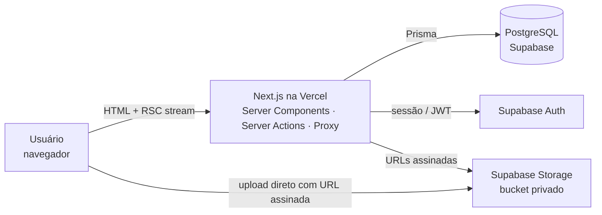
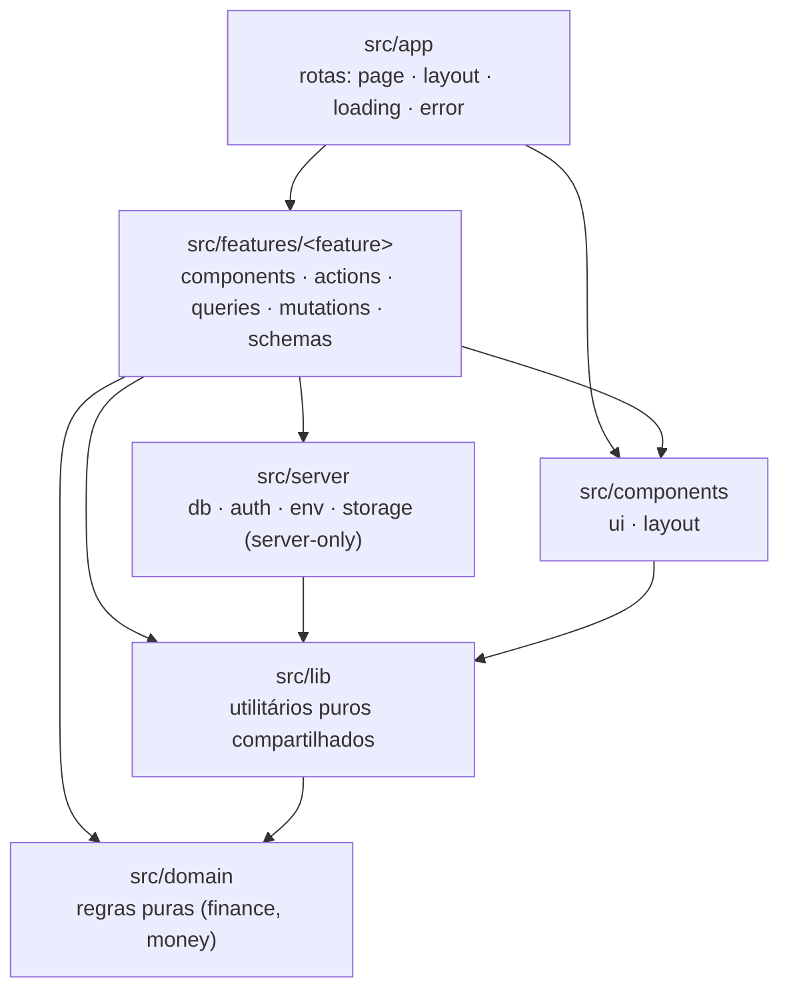
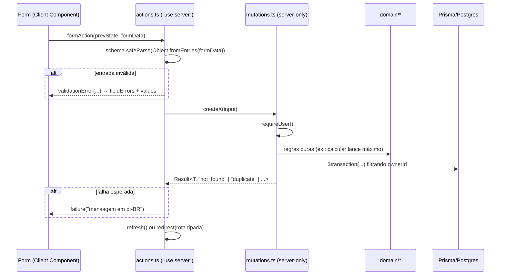

# Leilão Tracker — System Design

> Versão 1.0 • 26/09/2026 • Complementa o [`SPEC.md`](../SPEC.md) (o quê), o [`DESIGN.md`](../DESIGN.md) (visual) e o [`OPERACAO.md`](OPERACAO.md) (deploy, backup e restauração). Este documento define **como** o sistema é construído. Toda decisão estrutural nova entra no [Registro de decisões](#15-registro-de-decisões).
>
> Base técnica: Next.js 16.3 (App Router, Turbopack, Cache Components), React 19.3, TypeScript 6 e a documentação oficial em `node_modules/next/dist/docs/`.

## 1. Princípios

1. **O servidor é a fonte da verdade.** Dados são lidos em Server Components e alterados por Server Actions. Não há API REST própria nem estado global de dados no cliente. A API JSON para consumidores externos já tem contrato definido (§17) e só será implementada quando houver consumidor.
2. **Regras de negócio são código puro.** Cálculo financeiro, elegibilidade e comparação ficam em `src/domain`, sem React, Next ou banco. Por isso são fáceis de testar e rodam tanto no servidor quanto na prévia do navegador.
3. **Segurança perto do dado.** Toda leitura e escrita passa pela Data Access Layer (DAL), que autentica, filtra por `owner_id` e devolve DTOs mínimos. Proxy e UI são só conveniência.
4. **Erros esperados são valores; erros inesperados são exceções.**
5. **Uma forma de fazer cada coisa.** Cada tipo de arquivo tem um padrão, com receita na skill `leilao-padroes`.
6. **Dinheiro em centavos inteiros e datas em UTC.** A conversão para reais e para `America/Sao_Paulo` acontece só na borda (formulário e exibição).

## 2. Contexto



- Uso individual e privado, mas **todo registro tem `owner_id`** desde o início. Isso mantém a autorização explícita e o custo de abrir para mais usuários baixo.
- O navegador nunca fala com o banco. Com o Supabase, fala apenas com Auth (login) e Storage (upload/download por URL assinada).

## 3. Camadas e regra de dependência



As setas indicam "pode importar". Não existe seta no sentido contrário.

| Camada | Responsabilidade | Pode importar | Nunca |
| --- | --- | --- | --- |
| `src/app` | Roteamento e composição da página. Lê `params`/`searchParams`, delega à feature e define `<Suspense>`/boundaries. | features, components, lib | Prisma, regra de negócio, `fetch` direto |
| `src/features/<f>` | Uma fatia do produto: leilões, lotes, análises, resultados, dashboard. | domain, server, components, lib, `@/features/<outra>/queries` | UI, actions ou schemas de outra feature. Para mostrar UI de duas features juntas, a **rota compõe** (ex.: o detalhe do leilão recebe a lista de lotes como slot `lots`). |
| `src/domain` | Regras puras e tipos de domínio (`Cents`, calculadora, elegibilidade). | apenas `src/domain` | React, Next, Prisma, `process.env`, `Date.now()` implícito |
| `src/server` | Infraestrutura server-only: cliente Prisma, sessão, env validado, Storage e o **coletor** (`server/collector`, D-26). | lib, domain, sources | componentes, features |
| `src/sources/<fonte>` | Adaptador de site de leilão (D-27, D-37): descobre os anúncios e converte a página em anúncio normalizado. Faz as requisições pela interface `SourceHttp` que o coletor injeta, sem importar rede. Registro em `src/sources/index.ts`. | domain, lib, `zod` | rede, Prisma, `process.env`, React/Next, features |
| `src/components` | Primitivas visuais (`ui`) e casca (`layout`), sem conhecer regras de negócio. | lib, **tipos** de `domain` (ex.: `Money` recebe `Cents`) | features, server, funções de domain |
| `src/lib` | Utilitários puros: `cn`, formatação, `ActionState`, `Result`. | domain (tipos) | server, features |

As fronteiras são **verificadas por ferramenta**:

- `import "server-only"` em todo arquivo de `src/server` e em `queries.ts`/`mutations.ts`. Importá-los no cliente quebra o build.
- ESLint `no-restricted-imports` (`eslint.config.mjs`):
  - Prisma/`@/server/db` só em `src/server/**`, `queries.ts` e `mutations.ts`.
  - `src/domain` não importa framework nem outras camadas.
  - `src/sources` não importa framework, banco nem infraestrutura.

## 4. Estrutura de pastas

```text
src/
  app/
    layout.tsx                    # raiz: fontes, <html lang="pt-BR">, Providers
    (auth)/login/page.tsx
    (private)/
      layout.tsx                  # casca autenticada (nav); sessão lida dentro de <Suspense>
      dashboard/page.tsx
      leiloes/page.tsx            # catálogo por leilão (D-42)
      leiloes/veiculos/page.tsx
      leiloes/[source]/[auction]/page.tsx
      minhas-analises/page.tsx
      minhas-analises/leiloes/[id]/page.tsx
      lotes/[id]/page.tsx
      analise/[id]/page.tsx
      pesquisa/page.tsx           # gráficos de preço do catálogo (D-45)
      error.tsx                   # boundary da área privada
    not-found.tsx
    global-error.tsx
  proxy.ts                        # renovação da sessão Supabase + redirecionamento otimista
  components/
    ui/                           # primitivas (ver DESIGN.md e components/ui/README.md)
    layout/                       # PageHeader, AppShell, navegação
    charts/                       # gráficos em SVG próprio (D-45); mapa do Brasil e dispersão são Client Components (D-46, D-62)
  features/
    auctions/
      components/                 # auction-form.tsx, auction-list.tsx, ...
      actions.ts                  # "use server" — adaptadores finos
      queries.ts                  # server-only — leituras → DTO
      mutations.ts                # server-only — escritas, autorização, transações
      schemas.ts                  # Zod: entrada de formulário (compartilhado cliente/servidor)
      types.ts                    # DTOs expostos à UI
    lots/ analyses/ results/ dashboard/ research/
  domain/
    money.ts                      # Cents, parseBRL, roundCents
    finance/                      # calculadora (SPEC §7), versionada por FORMULA_VERSION
    research/                     # da agregação à tela da Pesquisa: amostra mínima, faixas de cor, estados (D-45)
  server/
    db.ts                         # PrismaClient singleton
    auth.ts                       # getCurrentUser / requireUser / signIn / signOut (DAL de sessão)
    supabase.ts                   # cliente Supabase do servidor (cookies)
    env.ts                        # variáveis secretas validadas por Zod
    storage.ts                    # URLs assinadas
    collector/                    # coletor agendado: rede educada, gravação do catálogo, registro das execuções (D-26); carga avulsa (D-60)
    fipe/                         # tabela FIPE do mês (dataset), catálogo, correlações e casamento do valor (D-47, D-49, D-51)
  sources/
    index.ts                      # SOURCES: as fontes coletadas (D-37)
    leilo/                        # adaptador da fonte: discover(), fetchListing() + fixtures/ com páginas salvas (D-27)
    patio-sao-carlos/             # segunda fonte: listas por categoria + consulta interna de situação (D-37)
    detran-mg/                    # leilões do Detran-MG: listas por leilão + consulta de situação em lote (D-48)
    leilao-online/                # Leilão Online (JUCESP): listas por leilão + uma página por lote (D-50)
    detran-sc/                    # leilões do Detran-SC nos sites Astavero: lista por site + API do lote (D-57)
    superbid/                     # Superbid Exchange: API JSON de ofertas, descoberta paginada por categoria + oferta pelo id (D-58)
    leiloes-pb/                   # Leilões PB (Suporte Leilões): eventos da página inicial + JSON embutido na página do lote (D-67)
    shared/                       # extração de HTML, descoberta por sitemap, contrato comum, redação e marca/modelo do registro (Detran)
  lib/
    utils.ts  format.ts  action-state.ts  result.ts  schemas.ts  public-env.ts
prisma/
  schema.prisma
  migrations/
tests/
  e2e/                            # Playwright (fluxos completos)
  stubs/                          # substitutos para ambiente de teste
```

**Regras de nomes**

- Arquivos e pastas em `kebab-case`. Componentes em `PascalCase`. Funções e variáveis em `camelCase`. Constantes de módulo em `SCREAMING_SNAKE_CASE`.
- Identificadores, tipos e comentários de código em **inglês**. Textos da interface, mensagens de erro ao usuário e documentação em **português do Brasil**.
  - Glossário: leilão = `auction`, lote = `lot`, análise = `analysis`, resultado = `result`, lance = `bid`, comissão = `commission`, margem = `margin`, anúncio coletado = `listing`, fonte = `source`, monitor = `watch`, alerta = `alert`.
- As URLs seguem o português do SPEC (`/leiloes`, `/minhas-analises`, `/lotes/[id]`, `/analise`), e as pastas de feature usam o inglês.
- Server Actions terminam em `Action` (`createAuctionAction`). O plugin TypeScript do Next só aceita props de função com nome `action` ou terminadas em `Action` em Client Components.
- Schemas Zod terminam em `Schema` (`auctionInputSchema`), com o tipo inferido correspondente (`AuctionInput`).
- DTOs descrevem o uso: `AuctionListItem`, `LotDetail`, `AnalysisSnapshot`.
- **Named exports sempre.** Default export só onde o Next exige (`page`, `layout`, `error`, `proxy` etc.).

## 5. Renderização e cache (Cache Components)

`cacheComponents: true` está ligado. Nesse modelo, tudo é **dinâmico por padrão**: o Next pré-renderiza uma *static shell* e faz streaming das partes que dependem de request ou dados.

Regras do projeto:

1. **Toda leitura de sessão ou de dados fica dentro de um `<Suspense>`**, com fallback de `Skeleton`. Sem isso o dev overlay aponta *blocking route*, e isso é tratado como erro.
2. **O que é estático fica fora do Suspense** (título da página, `PageHeader`, navegação) e entra na shell.
3. **Nada de `await` de sessão no topo de layout.** O layout privado renderiza a casca, e só o componente que mostra o usuário lê a sessão, dentro do próprio `<Suspense>`.
4. **Sem `"use cache"` para dados de domínio no MVP.** Os dados são privados, pequenos e precisam refletir a última escrita (análises e resultados). Cache em memória de servidor serverless traria pouco ganho e risco de dado velho. Se uma leitura cara surgir (ex.: agregados do dashboard), a regra é:
   - `"use cache"` + `cacheLife(...)` + `cacheTag(\`<entidade>:${userId}\`)` numa função **não exportada**, chamada por uma query exportada que resolve o usuário;
   - invalidação com `updateTag` na mutation;
   - registro da decisão aqui.
5. **`params` e `searchParams` são Promises.** Tipar com os helpers globais gerados por `next typegen`: `PageProps<"/lotes/[id]">`, `LayoutProps<...>`, `RouteContext<...>`.
6. **Links tipados** (`typedRoutes`). Rotas dinâmicas não literais usam `as Route`.
7. **Navegação preserva estado** (React `<Activity>`). Dialogs e menus abertos devem fechar ao sair da rota. Ver `02-guides/preserving-ui-state.md`.
8. **React Compiler ligado.** Não escrever `useMemo`, `useCallback` ou `memo` por desempenho.

Exemplo de página:

```tsx
// src/app/(private)/minhas-analises/page.tsx
export default function MyAnalysesPage() {
  return (
    <>
      <PageHeader title="Minhas análises" actions={<NewAuctionButton />} />
      <Suspense fallback={<AuctionListSkeleton />}>
        <AuctionList />   {/* async Server Component: chama listAuctions() */}
      </Suspense>
    </>
  );
}
```

## 6. Autenticação e autorização

| Onde | O que faz | É barreira de segurança? |
| --- | --- | --- |
| `src/proxy.ts` | Renova a sessão Supabase com `getClaims()` (padrão oficial `@supabase/ssr`). Redireciona para `/login?next=<rota>` quem não tem sessão e para `/dashboard` quem já está logado em `/login`, preservando os cookies renovados no redirect. Não acessa o banco. | Não (otimista) |
| `src/server/auth.ts` | `getCurrentUser()` valida o JWT com `supabase.auth.getClaims()` (assinatura verificada; **nunca** `getSession()` no servidor), com memo por request via `React.cache`. `requireUser()` redireciona para `/login` quando não há usuário. Login e logout também ficam aqui e retornam `Result`. | **Sim** |
| `queries.ts` / `mutations.ts` | Chamam `requireUser()` e filtram **toda** consulta por `ownerId: user.id`. | **Sim** |
| `actions.ts` | Delegam à mutation, que já autentica. Nunca confiam em ids de dono vindos do cliente. | Via mutation |
| Layouts | Não fazem checagem de auth, porque não re-renderizam em toda navegação. | Não |

- O cliente envia **referências** (ids) e a mudança desejada. Dono, status e valores derivados são relidos do banco pela sessão.
- Registro de outro dono é tratado como "não encontrado", sem revelar que ele existe. Na leitura, a query devolve `null` e o componente chama `notFound()`. Na escrita, a mutation devolve `err("not_found")`.
- DTOs só contêm o que a tela usa. Nunca repassar o objeto do Prisma para um Client Component.

## 7. Leitura de dados

```text
page.tsx ──► <Suspense> ──► Async Server Component (feature/components)
                                  │
                                  ▼
                        queries.ts  (import "server-only")
                          1. const user = await requireUser()
                          2. prisma.<model>.findMany({ where: { ownerId: user.id, ... }, select: {...} })
                          3. return row ? toDTO(row) : null   ← tipos em types.ts
```

- `select` explícito em toda consulta, sem `include` genérico.
- Buscas independentes em paralelo com `Promise.all`, sem waterfall.
- Client Components recebem dados por props, já serializáveis: `Date` ou string ISO, e centavos como `number`.
- Leitura de filtros: `searchParams` validado por um schema Zod em `schemas.ts` (valores inválidos caem no padrão, sem lançar erro).
- **Agregação no banco (D-45).** Quando a tela precisa de estatística sobre muitas linhas (mediana, percentis, histograma), a consulta agrega no Postgres e devolve só os grupos. Usa `$queryRaw` com **template marcado** (parâmetros ligados, nunca `$queryRawUnsafe` nem concatenação) e valida cada linha com um schema Zod antes de virar DTO. Regra que existe também em TypeScript (como `vehicleKey`) tem teste garantindo que os dois lados agrupam igual.

## 8. Mutações



Contratos:

- **Assinatura da action de formulário:** `(prev: ActionState, formData: FormData) => Promise<ActionState>`. O formulário usa `useActionState(action, idleState)`.
- **Ações sem formulário** (arquivar, fixar) recebem ids por `.bind(null, id)` e seguem o mesmo retorno.
- **Mutations retornam `Result`** (`src/lib/result.ts`) para falhas de negócio (`"not_found"`, `"duplicate_lot_number"`, `"analysis_already_fixed"`). Erros inesperados são lançados.
- **Depois de escrever:** `redirect()` quando a tela muda (criação → detalhe) ou `refresh()` quando fica na mesma rota. Se no futuro houver `"use cache"` com tag, usar `updateTag(tag)` antes.
- **`redirect()` fica fora de `try/catch`**, porque ele lança por design.
- **Operações compostas** (fixar análise, revisar resultado) acontecem numa `prisma.$transaction`. Unicidade (`auction_id, lot_number`) e (`lot_id, revision`) é garantida pelo banco, e o erro `P2002` vira `err("duplicate_...")` na mutation.
- **Retorno mínimo:** nunca devolver registro do banco para o cliente.

## 9. Validação

- **Schemas Zod ficam em `features/<f>/schemas.ts`** e são a única definição da forma da entrada. O cliente pode usá-los para feedback imediato, e o servidor **sempre** revalida.
- **Conversões de borda acontecem no schema:**
  - texto em reais → `Cents` com `parseBRL`;
  - `""` → `undefined` nos campos opcionais;
  - datas locais → `Date` UTC;
  - `trim` em textos.
- **Mensagens de erro em pt-BR** no próprio schema.
- **`searchParams`, `params` e `FormData` são sempre `unknown`** até passarem por um schema.
- **O banco também valida.** Constraints `NOT NULL`, `CHECK` (valores ≥ 0) e `UNIQUE` duplicam as regras críticas.

## 10. Tratamento de erros

| Situação | Mecanismo | UI |
| --- | --- | --- |
| Campo inválido | `validationError()` → `ActionState` | Erro no campo (`fieldError`) e valor preservado (`fieldValue`) |
| Regra de negócio / conflito | `Result` na mutation → `failure()` | `Alert` no formulário ou `toast` |
| Registro inexistente, de outro dono ou id inválido | query devolve `null` → componente chama `notFound()` | `not-found.tsx` |
| Sessão ausente | `requireUser()` → `redirect("/login")` | Login |
| Bug / falha de infraestrutura | exceção | `error.tsx` do segmento (prop `retry`), `catchError` para trechos isolados, `global-error.tsx` |
| Erro em event handler do cliente | `try/catch` local + estado | `toast` |

Mensagens técnicas (stack, SQL) nunca chegam ao usuário. O `error.tsx` mostra texto genérico e `digest`, e registra o erro com `console.error`.

## 11. Domínio financeiro

- `src/domain/finance/calculator.ts` implementa o SPEC §7 com `Cents` e `Bps`, sem `Date.now()` ou I/O:
  - `calculateMaxBid(inputs)` devolve `{ kind: "viable", maxBid, … } | { kind: "not_viable" } | { kind: "incomplete", missing }`. Ausência (`null`) nunca vira zero.
  - `simulateBid(complete, bid)` calcula comissão, custos fora do lance, custo total e margem estimada.
  - `compareToLimit(outcome, bid)` classifica em `below_limit | at_limit | above_limit | no_viable_bid | unavailable` (§7.5). Os rótulos em pt-BR ficam na feature.
- **Lance máximo exato ao centavo:** parte da divisão teórica e ajusta depois de arredondar a comissão, até o maior lance que satisfaz `custo total + M ≤ V`. Um teste com 1.000 entradas geradas confirma que o lance máximo cabe e que o centavo seguinte não cabe.
- **Comissão percentual** por `applyRate`, com aritmética inteira e arredondamento half-up, sem ponto flutuante no produto.
- **`FORMULA_VERSION` é exportada** e persistida junto das saídas fixadas (`analyses.formula_version`). Mudança de fórmula exige nova versão e nunca recalcula análises históricas.
- A **prévia** (Client Component) importa a mesma função que a mutation usa para fixar a análise. Na fixação, o servidor recalcula a partir das entradas e ignora saídas vindas do cliente.
- **Percentuais em basis points inteiros** (`commission_rate_bps`), sem ponto flutuante persistido.
- **A cobertura de testes do domínio é obrigatória:** exemplos do SPEC §7.3/7.4, bordas de arredondamento, "sem lance viável" e entradas incompletas.

## 12. Persistência

- **Prisma 7** (gerador `prisma-client`, sem engine Rust) acessa o PostgreSQL do Supabase. O cliente é gerado em `src/generated/prisma` (fora do Git, gerado no `postinstall`) e instanciado uma vez em `src/server/db.ts` com `@prisma/adapter-pg`, com singleton em dev para o HMR.
- **Duas conexões:** a aplicação usa `DATABASE_URL` (pooler de transação, porta 6543, `pgbouncer=true`). A CLI usa `DIRECT_URL` (pooler de sessão, porta 5432), configurada em `prisma.config.ts`. O Prisma 7 não tem mais `url`/`directUrl` no `schema.prisma`.
- **`prisma.config.ts` carrega `.env*` com `@next/env`**, o mesmo carregador do Next, então não há `dotenv` nem arquivo `.env` separado para o Prisma.
- **Migrations versionadas em `prisma/migrations`**, criadas com `prisma migrate dev` e aplicadas em produção com `prisma migrate deploy`. Nunca editar migration já aplicada.
- **Convenções de schema:**
  - tabelas e colunas em `snake_case` (`@@map`/`@map`), modelos em `PascalCase`;
  - ids `uuid`;
  - `created_at`/`updated_at` gerados pelo banco e datas em `timestamptz`;
  - valores monetários em `integer` de centavos, até R$ 21.474.836,47 (D-15);
  - arquivamento lógico por `archived_at`.
- **Data API do Supabase fechada (D-14):** toda tabela nasce com `ENABLE ROW LEVEL SECURITY` **sem políticas** e com `REVOKE ALL ... FROM anon, authenticated`, no SQL da própria migration. A chave publicável do navegador não lê nem escreve nada. O Prisma conecta como `postgres`, que ignora RLS, e a autorização fica na DAL.
- **Imutabilidade:** análises `fixed` e revisões de resultado nunca recebem `UPDATE` nem `DELETE` nas mutations. Correção = nova revisão (SPEC RF-05/RF-06).
- **Índices** conforme SPEC §8, declarados no `schema.prisma` (índices parciais com o preview `partialIndexes`).
- **SQL fora do Prisma:** CHECKs, triggers e RLS são escritos à mão na migration, criada com `prisma migrate dev --create-only`. Depois de aplicar, `prisma migrate diff --from-config-datasource --to-schema prisma/schema.prisma --exit-code` deve sair com 0 (sem drift).

## 13. Arquivos (fotos)

- **Bucket privado.** O upload vai **direto do navegador para o Storage** com uma URL assinada de upload criada por Server Action. Isso evita o limite de 1 MB de body das actions.
- **A action valida antes de emitir a URL:** dono do lote, tipo MIME (`image/jpeg|png|webp`) e tamanho. Depois do upload, outra action registra `lot_images`.
- **Exibição por URL assinada de curta duração** (1 h), gerada no servidor.
- **Bucket `lot-images` privado**, com limite de 5 MB e JPEG/PNG/WebP no próprio Storage, e políticas `SELECT`/`INSERT`/`DELETE` restritas à pasta `<owner_id>/…`. Sem `UPDATE`: arquivo não é sobrescrito. Configuração em `prisma/sql/storage.sql` (D-20).
- **Ordem das operações:** registro no banco só depois de conferir o arquivo, e remoção do arquivo só depois de apagar o registro. Uma falha do Storage deixa, no pior caso, um arquivo órfão, nunca uma foto registrada que não abre (SPEC §11).

## 14. Configuração, qualidade e testes

**Ambiente**

- `src/server/env.ts` (server-only) valida as variáveis **secretas** com Zod na primeira importação. `src/lib/public-env.ts` valida as **públicas** (`NEXT_PUBLIC_*`, lidas pelo nome literal para o Next embutir no bundle), usadas pelo proxy e pelos clientes Supabase. Nenhum outro arquivo lê `process.env`.
- `.env.example` lista todas as variáveis, e `.env*` é ignorado pelo Git.

**Ferramentas e scripts**

| Comando | Uso |
| --- | --- |
| `npm run dev` | Desenvolvimento (Turbopack) |
| `npm run check` | typecheck + lint + format:check + test. **Obrigatório antes de concluir qualquer tarefa.** |
| `npm run build` | Build de produção. Obrigatório ao mexer em rotas, config ou fronteira server/client. |
| `npm run format` / `lint:fix` | Correções automáticas |
| `npm run db:migrate` / `db:storage` | Migrations do Prisma (+ `generate`) / bucket e políticas do Storage |
| `npm test` / `test:watch` | Vitest |

- **TypeScript estrito**, com `noUncheckedIndexedAccess`, `noImplicitReturns`, `noImplicitOverride` e `noFallthroughCasesInSwitch`.
- **ESLint** com as regras do Next e `typescript-eslint` com informação de tipos:
  - `no-floating-promises`, `no-misused-promises`, `switch-exhaustiveness-check`, `consistent-type-imports`;
  - sem `any` e sem `!`;
  - imports ordenados;
  - fronteiras de camada.
- **Prettier** (largura 120, classes Tailwind ordenadas) é a única fonte de formatação.

**Pirâmide de testes**

| Nível | Ferramenta | Alvo | Local |
| --- | --- | --- | --- |
| Unitário | Vitest | `domain`, `lib`, schemas, componentes síncronos | `*.test.ts(x)` ao lado do arquivo |
| Integração | Vitest + banco de teste | `mutations`/`queries` (unicidade, versões, autorização) | `*.int.test.ts` (quando o banco existir) |
| E2E | Playwright + `@next/playwright` | Fluxo SPEC §13, critérios de aceite de interface e casca estática (`instant()`) | `tests/e2e` (`npm run test:e2e`; usuário de testes dedicado) |

## 15. Registro de decisões

| # | Decisão | Motivo | Alternativa descartada |
| --- | --- | --- | --- |
| D-01 | `cacheComponents: true` desde o início | É o modelo atual do Next 16, com shell estática, streaming e validação de navegação instantânea. Migrar depois custa mais. | Modelo anterior (`dynamic`, `revalidate`) |
| D-02 | DAL por feature (`queries.ts`/`mutations.ts`) + `server/auth.ts` | Abordagem recomendada pelo Next para projetos novos: autorização centralizada e DTOs. | Consultas diretas em componentes |
| D-03 | Formulários com `useActionState` + Zod + `ActionState` | Padrão da documentação do Next e do React 19: progressive enhancement, sem estado duplicado. **Substitui React Hook Form do SPEC §9.** | React Hook Form |
| D-04 | Sem `"use cache"` para dados de domínio no MVP | Dados privados, poucos e sensíveis à última escrita | Cache por usuário com tags |
| D-05 | Dinheiro como `Cents` (inteiro com marca de tipo) | Elimina erros de ponto flutuante e confusão entre reais e centavos | `number` livre / `Decimal` |
| D-06 | React Compiler ligado | Memoização automática, estável no Next 16 | `useMemo`/`useCallback` manuais |
| D-07 | `typedRoutes` ligado | Links quebrados viram erro de compilação | Strings livres |
| D-08 | Vitest, com testes junto do código | Recomendado pelo Next. Substitui o runner `node --test` com transpilação manual. | Jest |
| D-09 | Prettier + `eslint-config-prettier` + `simple-import-sort` | Formatação sem debate. O `import/order` do plugin do Next não carrega o resolver TS nesta versão. | Formatação manual |
| D-10 | Código em inglês, interface e docs em pt-BR | Consistência com bibliotecas e glossário único | Misturar idiomas |
| D-11 | Upload direto ao Storage por URL assinada | Evita o limite de body das Server Actions e não passa arquivo pelo servidor | Upload via action/Route Handler |
| D-12 | Proxy só otimista; autorização real na DAL | Recomendação oficial: proxy roda em toda rota e prefetch | Checar banco no proxy |
| D-13 | Prisma 7.10.0 fixo, com adapter `pg` e env via `@next/env` | Última versão estável (a tag `latest` do pacote `prisma` aponta para 8.0 RC). O adapter é obrigatório no Prisma 7. | Snippet do Supabase (`prisma-client-js`, `directUrl`), Prisma 8 RC, `dotenv` |
| D-14 | RLS ligado sem políticas + `REVOKE` para `anon`/`authenticated` em todas as tabelas | O schema `public` é exposto pela Data API e a chave publicável é pública. Assim o único caminho até os dados é o servidor. | Políticas RLS por usuário (duplicariam a DAL) ou schema privado |
| D-15 | Centavos em `integer` (int4), não `bigint` | O teto de R$ 21 milhões por valor cobre veículos com folga, e o Prisma mapeia `Int` para `number`, compatível com `Cents`. `BigInt` viraria `bigint` no JS e exigiria conversão em toda leitura. | `bigint` / `Decimal` |
| D-16 | Integridade no banco: FKs compostas `(id, owner_id)`, índices únicos parciais, CHECKs e triggers de imutabilidade | O SPEC §8 exige relações do mesmo dono, um rascunho por lote e análises e resultados imutáveis. O banco garante isso mesmo se a aplicação falhar. CHECKs, triggers e RLS ficam no SQL da migration, porque o Prisma não os modela. | Validar só na aplicação |
| D-17 | Sem API JSON própria no MVP; contrato da futura API definido em §17 | A tela usa a DAL direto (recomendação do Next). A separação está no código (`domain` e DAL devolvem DTOs serializáveis), então a API vira um adaptador fino quando houver consumidor externo. | API JSON consumida pela própria tela; backend separado |
| D-18 | Supabase Auth com `@supabase/ssr` 0.12 + `getClaims()`, Node ≥ 22 | Padrão do guia oficial de Next.js (o SDK `@supabase/server` é genérico). `getClaims()` verifica a assinatura do JWT localmente com chaves assimétricas. As bibliotecas Supabase JS deixaram de suportar Node 20 em 30/06/2026. | `getSession()` no servidor; `getUser()` em toda requisição; `@supabase/server` |
| D-19 | Coluna `results.prior_declared` e temporalidade calculada no servidor a cada revisão | O SPEC §10 pede registrar a confirmação declarada quando o horário do desfecho é desconhecido, e o modelo do §8 não tinha onde. A regra (`classifyAnalysisTiming`) fica no domínio e é gravada em `analysis_timing` na própria revisão, nunca vinda do cliente. | Guardar a declaração em texto livre; recalcular a temporalidade na leitura |
| D-20 | Bucket e políticas do Storage em `prisma/sql/storage.sql` (idempotente, `npm run db:storage`); upload em 3 passos com conferência do arquivo real | O schema `storage` é do Supabase e não existe no shadow database do Prisma, então não pode ir em migration. O servidor autoriza e emite a URL, o navegador envia direto, e o servidor confere tamanho, tipo e assinatura binária antes de registrar. Arquivo inválido é removido. | Migration do Prisma; confiar no tipo declarado pelo navegador |
| D-21 | CSP sem nonce + cabeçalhos de segurança em `next.config.ts`; `robots.txt` e `noindex` | Nonce exige renderização dinâmica e é incompatível com o Partial Prerendering (guia de CSP do Next). A política restringe origens (própria e Supabase), bloqueia `object`, `frame-ancestors` e formulários externos. | CSP com nonce; SRI (experimental) |
| D-22 | Backup e restauração por scripts Node (`npm run backup`/`restore`), com simulação por padrão, destino explícito e vazio, transação única e `--owner` para projeto novo | Sem `pg_dump` local, e o Supabase Free não oferece download de backups. O formato JSON é validado contra as mesmas garantias do banco; ensaio com dados sintéticos restaurou conteúdo idêntico. | `pg_dump` (dependência externa); backups do plano Supabase |
| D-23 | Automação do Claude Code versionada em `.claude/`: hooks em Node (`protect-files.mjs` bloqueia `.env*`, `backups/`, arquivos gerados e migrations versionadas; `format-file.mjs` roda `eslint --fix` + Prettier no arquivo editado), permissões (`allow` para verificações, `ask` para comandos que tocam o banco, `deny` de leitura de `.env`/`.env.local`/`backups/`), subagente `leilao-reviewer` e MCP do Supabase em `.mcp.json` **somente leitura** | O agente segue as regras sem depender de memória, e comandos destrutivos pedem confirmação. Hooks em Node rodam igual no Windows e no CI, sem `jq`. O MCP é só para diagnóstico: schema continua só por migrations do Prisma. | Git hooks (husky); hooks em bash com `jq`; MCP com escrita |
| D-24 | Estado preservado entre navegações (Cache Components usa `<Activity>`): formulário de **edição** recebe `key` derivada do dado (`updatedAt`, revisão do resultado); formulário de **cadastro** fica dentro de `FreshOnNavigation` (`key={useRouter().bfcacheId}`) | O Next esconde a página anterior em vez de desmontá-la, e o estado do cliente volta junto. Sem isso, "Corrigir resultado" abria com o estado da primeira visita (sem desfecho) e "Novo leilão" voltava com o cadastro anterior. `key` do dado é a forma que a doc do Next recomenda; `bfcacheId` cobre cadastros, que não têm dado próprio, e ainda restaura no voltar do navegador. | `cacheComponents: false`; limpar estado em efeitos |
| D-25 | Catálogo de anúncios coletados **global** (`sources`, `listings`, `listing_observations`, `collector_runs`, `municipalities`), sem `owner_id`; monitores, alertas e lotes continuam por dono | Anúncio é dado público e igual para todos; duplicar por usuário desperdiça coleta. Exceção explícita à regra "todo registro tem `owner_id`" (§2). RLS ligado e sem acesso pela API de dados (D-14), como as demais tabelas | Catálogo por usuário |
| D-26 | Coletor em `src/server/collector` + `scripts/collect.ts`, executado pelo **GitHub Actions** (cron de 2 em 2 horas, `concurrency` sem sobreposição) com **`tsx`** (dev). Roda **sem usuário**: é a única escrita fora da DAL com `requireUser()`, e só grava o catálogo global | Grátis para este volume; o cron gratuito da Vercel é diário e as funções são curtas. Reaproveita domínio, Zod e Prisma. Migra para servidor pequeno se horário ou volume exigirem | Vercel Cron; Edge Functions (Deno, sem Prisma); servidor dedicado desde o início |
| D-27 | Adaptador por fonte em `src/sources/<fonte>`: descoberta por **sitemap** (`lastmod`), leitura do **estado serializado da página** (Leilo: `window.__INITIAL_STATE__`) e do **JSON-LD** como reserva, tudo validado com Zod; `parse` é puro e testado com páginas salvas. Navegador automatizado só se uma fonte exigir | O estado da página traz o lote completo (situação, lance final, custos, FIPE); o JSON-LD é padrão schema.org e cobre o núcleo se o estado mudar. Classes CSS do site têm versão no nome e mudam | Seletores CSS; Playwright para tudo |
| D-28 | Estimativas (preço provável de arremate e limite estimado) **só com dados do sistema** (arremates observados e análises fixadas do usuário), com amostra mínima, faixa e `n` visíveis; nunca fixam análise | Pedido do usuário; transparência; o indicador continua medindo a decisão do usuário, não uma fórmula | FIPE ou tabela externa como base |
| D-29 | Fotos do catálogo guardadas como **URL da fonte**; nada é copiado para o Storage (fotos enviadas pelo usuário continuam no bucket privado) | Evita custo e questões de direito de imagem; o anúncio já é público | Copiar todas as fotos |
| D-30 | Dados da fonte (valor de mercado, custos, comissão) entram no rascunho de "Adicionar à análise" como **sugestão rotulada com a fonte**; o usuário revisa e fixa | Menos digitação sem esconder a origem do número; a fixação continua sendo a decisão do usuário | Não usar os dados da fonte; tratá-los como estimativa do sistema |
| D-31 | **Login desligado no desenvolvimento local** para conferir telas (inclusive pelo agente): `npm run dev:local` escuta só em 127.0.0.1:3100 e, com `DEV_AUTH_BYPASS=true` + `DEV_AUTH_USER_ID` (usuário de testes) no `.env.local`, `getCurrentUser()` e o proxy assumem esse usuário. Travas: só `NODE_ENV=development`, só pelo script (`DEV_AUTH_LOOPBACK=1`), só Host local, UUID válido, selo "Modo dev" na conta; na Vercel a variável derruba o build. A DAL continua filtrando por dono | Verificar UI sem digitar senha em serviço hospedado; `npm run dev` (rede local, porta 3000, E2E) segue com login | Sessão de teste gravada em arquivo; usar a conta real |
| D-32 | **Alertas criados pelo coletor**, ao fim de cada execução (`src/server/collector/alerts.ts`): lê os monitores ligados de **todos** os usuários e grava cada alerta com o `owner_id` do monitor. Regra pura em `src/domain/listings/alerts.ts` e `criteria.ts` (a mesma de "Descobertos"). Só anúncios vistos pela primeira vez depois de `alerts_from` do monitor (criação, edição dos critérios ou religar) e dentro de 48 h; um alerta por par monitor × anúncio (índice único) | Alerta chega junto com a coleta, sem outro agendamento; a janela recupera uma execução que falhou; o par único impede repetição quando o lance muda. Amplia D-26: além do catálogo, o coletor só **insere** em `alerts` e só **lê** `watches` | Gerar alertas ao abrir o app (atrasaria e dependeria de acesso); job separado |
| D-33 | **Disparo da coleta pelo `pg_cron` do Supabase**: de 2 em 2 horas, o job `leilao-coleta` chama a API do GitHub (`workflow_dispatch` do workflow Coleta) com um token _fine-grained_ só deste repositório e só com permissão de Actions, guardado no **Vault** (`github_workflow_token`). SQL idempotente em `prisma/sql/cron.sql` (`npm run db:cron`), fora das migrations, como o Storage. O cron do GitHub fica como reserva a cada 12 h | O agendamento do GitHub atrasa e pula execuções (4 de 12 em 28/09/2026). O `pg_cron` dispara no horário, sem custo e sem servidor novo; a coleta continua no Actions (D-26) | Serviço externo de cron (outra conta, outro segredo); mover a coleta para função da Vercel (o Cron da Vercel no Hobby é diário) |
| D-34 | **"Adicionar à análise" e acompanhamento automático** (etapa 3): `lots.listing_id` liga o lote ao anúncio (único por dono) e `auctions.source_id` + `external_id` ligam o leilão ao da fonte (único por dono), para não duplicar. A regra pura está em `src/domain/listings/tracker.ts` (`planTracker`, `shouldSyncBid`); a mutation cria leilão, lote acompanhado e rascunho v1 numa transação, com as sugestões da fonte rotuladas (D-30). O coletor revisita primeiro os anúncios abertos ligados a lotes ativos (a cada execução) e, ao fim, copia o lance para os lotes ligados de **todos** os usuários (`src/server/collector/lots.ts`), só quando a leitura é mais nova que a observação do lote e o valor mudou (lote arquivado não é atualizado). Adicionar de novo um anúncio de leilão arquivado desarquiva o leilão. O cartão de anúncio (`ListingCard`, com o botão e sua action) é compartilhado com a feature de alertas | O lance do lote se mantém sozinho sem o app escrever no catálogo global; o lance digitado pelo usuário não é apagado por uma leitura antiga. Amplia D-26 e D-32: o coletor passa a **ler** `lots` e a **atualizar** só `current_bid_cents` e `current_bid_observed_at` (o `updated_at` acompanha) | Copiar o anúncio para o lote só no clique (o lance envelheceria); gatilho no banco (regra escondida do código e dos testes) |
| D-35 | **Resultado automático** (etapa 4): ao fim de cada execução, o coletor grava a **revisão 1** do resultado nos lotes ligados (D-34) sem resultado cujo anúncio tem desfecho definitivo (vendido → arrematado com o lance final; não vendido; retirado), com `results.source = collector`, o link do anúncio, a hora do fim e a análise sugerida pela mesma regra do formulário (`suggestedAnalysis`), com a temporalidade calculada por `classifyAnalysisTiming`. Participação fica "acompanhei" (a fonte não diz quem arrematou). Condicional, desconhecido ou coletor que desistiu **não** viram resultado: a ficha e o dashboard mostram **"resultado a confirmar"** e o formulário vem preenchido. Regra pura em `src/domain/listings/outcome.ts`. Resultado já registrado pelo usuário nunca é tocado; correção segue sendo nova revisão. Vale também para lote arquivado (resultado é histórico) e para lote manual ligado depois ao anúncio. Lance zero no catálogo não vira preço final. Falha de um lote vai para `collector_runs.errors` sem impedir os outros. No dashboard, lote ligado só é pendência quando está "a confirmar". Anúncio já encerrado ao ser adicionado gera rascunho com `known_result_at_creation` (análise retrospectiva) | O usuário não digita resultado quando a fonte é inequívoca e confirma só o ambíguo; nada é adivinhado (a condicional pode ser negada). Amplia D-34: o coletor passa a **inserir** em `results` (só a revisão 1) e a **ler** as análises fixadas | Gravar a condicional como arrematado (erraria quando o vendedor nega); tabela separada de "resultados sugeridos" (o estado já sai do anúncio ligado, sem gravar nada) |
| D-36 | **Estimativas** (etapa 5; refina D-28), regra pura em `src/domain/listings/estimates.ts`. **Preço provável:** mediana e faixa P25–P75 dos lances finais de vendas **comparáveis** do catálogo no último ano, de **qualquer região** (mesma marca e modelo base, ano ±1, mesma condição declarada, km a até 40 mil), com no mínimo 5. Sem isso, **reserva pela proporção** lance final ÷ valor de mercado das vendas da mesma categoria e condição (mínimo 20), aplicada ao valor de mercado informado pela fonte e rotulada como tal. Sem nenhuma das duas: "sem base suficiente (x de 5)". Valores arredondados a R$ 100. **Limite estimado:** calculadora do SPEC §7 com a mediana das premissas da última análise fixada de cada lote do usuário com mesma marca, modelo base e ano ±1 (mínimo 3); o valor de mercado é o do próprio anúncio (a FIPE que o Leilo mostra, do veículo exato) e, sem ele, a mediana das análises. Só em anúncio aberto, no cartão (Descobertos e alertas). A base é carregada por tela, sem cache (D-04) | Região restrita zerava a base (até 300 km, nenhum lote com 5 comparáveis em 30/09/2026) e o leilão online recebe lances de todo o país; a proporção varia muito por categoria e condição (sucata 18%, carros 51%, motos 69%), por isso é calculada no mesmo grupo. Aprovado pelo usuário em 30/09/2026 | Raio de 150 km do plano original; proporção única para todo o catálogo; estimar o limite com premissas padrão (seria fórmula externa, contra D-28) |
| D-37 | **Várias fontes** (etapa 6; refina D-26 e D-27). Contrato do adaptador com `discover(http)` e `fetchListing(http, id)`: cada fonte decide quais requisições faz (sitemap e página no Leilo; listas por categoria, página e consulta interna de situação no Pátio), sempre pela interface `SourceHttp` do coletor, que mantém ritmo, identificação e novas tentativas (agora também `POST` de formulário). Fontes registradas em `src/sources/index.ts`, coletadas **em paralelo** (o intervalo mínimo é por site), cada uma com o seu `collector_runs` e isolada das outras; lance e resultado dos lotes ligados e alertas rodam **uma vez** depois de todas. A fonte se cadastra em `sources` na primeira execução (`active = false` pausa). Todo anúncio passa pelo **contrato comum** (`listingContractProblems`: id e URL canônica, centavos inteiros, datas válidas, categoria no **vocabulário comum** `LISTING_CATEGORIES`, fotos de origem liberada na CSP) antes de gravar. Cartão de saúde mostra a pior fonte e o nome das que falharam. Segunda fonte: **Pátio Estadual São Carlos** (veículos e motos; encerrados entram só até 3 dias depois do fim, porque a página sai do ar) | Escalar para 10–20 fontes sem mexer no coletor; uma fonte lenta ou quebrada não atrasa nem derruba as outras; categoria comum mantém filtros, monitores e estimativas valendo para o catálogo inteiro. Aprovado pelo usuário em 30/09/2026, ciente de que o Pátio não tem `robots.txt` e avisa contra cópia não autorizada (uso privado, volume baixo, fotos por link) | Sitemap obrigatório (o Pátio não tem); uma execução por fonte em sequência (estoura o tempo do job); notificações externas (fora do escopo por decisão do usuário) |
| D-38 | **Premissas padrão da análise** (refina D-30 e SPEC §7). Regra pura em `src/domain/finance/defaults.ts`: valor de venda = FIPE − desconto pela condição declarada (13% sem sinistro, 20/30/40% pequena/média/grande monta, sucata sem valor), reparos em % da FIPE pela condição com piso e acréscimos (airbag, peças faltando), pneus e revisão por tipo de veículo, documentação, transporte (remoção do anúncio ou guincho pela distância de estrada estimada até o pátio), outras taxas e comissão do anúncio quando há, senão padrão; reserva 5% e margem 15% do valor de venda. `src/features/analyses/draft-defaults.ts` monta o rascunho com a nota de origem; vale no "Adicionar à análise" e no primeiro rascunho de qualquer lote, e o editor tem "Estimar a partir da FIPE". **Reserva e margem em %:** colunas `risk_reserve_bps` e `desired_margin_bps`; o % tem precedência sobre o valor em R$ e, na fixação, as colunas em centavos guardam o valor aplicado (o CHECK de completude continua igual); `FORMULA_VERSION` 2. O limite estimado dos cartões (D-36) passa a usar a mesma venda pela FIPE e reserva e margem como % da venda (mediana do % de cada análise) | O usuário quer preencher o mínimo; números pessimistas por padrão protegem o limite, e a nota mostra a origem de cada um. Margem em % acompanha o valor de venda. Aprovado pelo usuário em 01/10/2026, com a tabela de valores | Campos em branco (D-30 original); margem só em R$; tela de configuração dos padrões por usuário (pode vir depois) |
| D-39 | **Direção visual A, "refinado e silencioso"** (substitui as definições visuais anteriores do DESIGN.md). Papel quente `#F7F7F4` na casca e conteúdo num painel branco embutido; tinta `#15171C` como `primary` (botão principal, controles marcados) e azul `#2B45C8` como novo token `accent` (link, foco, seleção, contador de alertas); fontes Hanken Grotesk e IBM Plex Mono por `next/font/google`; raio de controle 7 px; badges em pílula. DESIGN.md 2.0 é a fonte de verdade. Feita em duas etapas: tokens, componentes e casca; depois as telas | O usuário escolheu esta direção entre as do canvas de design em 01/10/2026: menos ruído, um número que decide por tela. Sem dependência nova (`next/font` já era usado) | Manter `#2454F8` e Geist; direção mais densa ou mais expressiva do canvas |
| D-40 | **Terceira fonte: Freitas Leiloeiro** (refina D-37; levantamento em `docs/PLANO-COLETA.md` §2.2). Adaptador em `src/sources/freitas/`: a agenda dá os leilões de pátio e veículos; a lista do leilão (`ListarLotes`, 100 por página) dá cartão, situação, lance e foto; monta, pátio e tipo saem **das consultas filtradas do próprio site** (monta → condição, pátio → local, tipo → categoria). **Memória por execução:** cartões e filtros de cada leilão são lidos uma vez e guardados num `WeakMap` preso ao `SourceHttp` da execução (some com ele; falha não fica guardada), em vez de repetir ~20 consultas por lote. A página do lote (comissão, despesas, observações, endereço de retirada) só é pedida **enquanto o lote está aberto**: depois da venda o site responde 500, e o desfecho vem do cartão, que continua na lista. Lote fora da lista é `gone`. **Teto próprio de visitas** (`maxVisitsPerRun` no contrato do adaptador, 250 na Freitas) abaixo do `--max-visits` geral, para a fonte com mais requisições por anúncio caber nos 20 min do job. BAIXA OFERTA fica sem mapeamento (desconhecida após o fim). **Placa completa, chassi e Renavam** são apagados da descrição antes de gravar (`src/sources/shared/redact.ts`) | Site com HTML no servidor e sem anti-robô; os filtros dão monta, pátio e tipo melhor que o texto livre. A memória por execução mantém o volume perto de 2 pedidos por lote aberto. Redação por decisão do usuário em 01/10/2026 | Página de cada lote encerrado (dá erro); condição só pelo texto; memória entre execuções no banco |
| D-41 | **Tempo por execução do coletor** (refina D-37). As fontes têm **12 min** por execução (`budgetMs`); o acesso educado recebe esse fim (`deadline`) e, depois dele, não faz requisição nem nova tentativa, e o tempo de cada requisição também para nele. Uma fonte para depois de **10 falhas seguidas do site** nas visitas (rede, tempo esgotado, recusa ou 5xx; 404/410 não contam). Anúncio que falha com a página em mãos (outro anúncio, formato novo) não conta e zera a sequência, porque prova que o site responde: em 07/10/2026 dez lotes republicados pela Leilo (URL antiga redireciona para o lote novo) pararam a fonte sem o site estar fora do ar. Redirecionamento para outro anúncio é página fora do ar (`gone`), como o 404. Em ambos os casos, um único registro diz quantos anúncios ficaram para a próxima execução, e os passos comuns (lotes ligados, alertas) rodam. No início, execuções ainda "running" há mais de 30 min são fechadas como falha ("interrompida antes do fim") | Em 02/10/2026 a Freitas passou a recusar e depois a deixar pendurados os pedidos vindos do GitHub Actions; com 20 s × 3 tentativas por pedido, a fonte segurou a coleta até o job de 20 min ser morto, e nenhuma fonte fechou o registro nem gerou alertas | Tempo por fonte em vez de por execução; fechar o registro de cada fonte antes dos passos comuns |
| D-42 | **Leilões do catálogo e Minhas análises** (plano em `docs/PLANO-NAVEGACAO.md`). `/leiloes` passa a ser o catálogo **agrupado por leilão** (e `/leiloes/veiculos`, os anúncios soltos, antigo `/descobertos`); o leilão do catálogo é **derivado dos anúncios**, sem tabela, agrupando `listings` por `(source_id, auction_external_id)` com índice nesse par, e a regra de data, nome e situação fica em `src/domain/listings/catalog-auctions.ts`. Os lotes do usuário e o registro do leilão vão para `/minhas-analises` (padrão: todos os lotes; opção por leilão) e `/minhas-analises/leiloes/[id]`. URLs antigas redirecionam em `next.config.ts` | A tela "Leilões" mostrava só os lotes analisados e um leilão de 300 lotes parecia ter 3. Todo anúncio já traz o leilão (07/10/2026: 41 leilões em 3 fontes), e o volume (~3,6 mil anúncios) cabe num agrupamento por consulta. `[id]` e `[source]/[auction]` não convivem no mesmo nível de rota | Só renomear as telas; mostrar "3 de 214" na tela antiga; tabela `catalog_auctions` mantida pelo coletor (fica para quando o volume pedir) |
| D-43 | **Filtros dos Leilões e de Minhas análises** (plano em `docs/PLANO-FILTROS.md`). Filtros aplicam na hora e vivem na URL; barra compacta (busca, Preço, Ano, Distância, Mais filtros) com popovers, painel lateral no desktop e gaveta inferior no celular, chips dos filtros ativos, total e ordem. `ListingCriteria` ganha preço mínimo, % do mercado, km, categorias múltiplas, esconder alertas da condição, fonte, origem, combustível e "só com chave", e vale também para os monitores (colunas novas em `watches`; `categories text[]` substitui `category`, que sai num release seguinte). Origem e combustível são **normalizados no domínio** a partir do texto da fonte. Preço e % do mercado viram **colunas geradas** (`price_cents`, `market_ratio_bps`, `STORED`) para filtrar e ordenar no banco; o restore ignora colunas geradas. Facetas e sugestões de busca saem de uma consulta leve e de regra pura (`src/domain/listings/facets.ts`). **Dependências novas:** `@radix-ui/react-popover` e `@radix-ui/react-slider`, base das primitivas `Popover` e `Slider` | Oito campos sempre visíveis, com botão "Filtrar", escondiam o estado e ocupavam a tela no celular; faltavam os critérios de compra (preço frente ao mercado, km, origem, prazo). Radix já é a base das primitivas (Dialog, Select, RadioGroup); popover e faixa de dois pontos acessíveis à mão custariam mais e teriam menos garantias. Coluna gerada não depende de o coletor lembrar de atualizá-la | Manter o formulário com botão; calcular % do mercado fora do banco (sem ordenar nem paginar no banco); trigger em vez de coluna gerada; `cmdk` para as sugestões |
| D-44 | **Dashboard orientado à próxima decisão** (plano em `docs/PLANO-DASHBOARD.md`; refina D-36 e o SPEC §5). A home mostra **"Para analisar agora"**: anúncios abertos no filtro padrão do catálogo (`DEFAULT_CRITERIA`) ou em algum monitor ligado, ainda sem lote do usuário, cujo preço provável cabe no limite. "Cabe com folga" quando P75 ≤ limite; "no limite" quando mediana ≤ limite < P75. A ordem é comparáveis antes de proporção, folga antes de "no limite" e encerra primeiro, até 6 cartões. Mostra também os acompanhados ordenados pelo fim do anúncio, com o preço provável ao lado do limite fixado, e os próximos leilões do catálogo na região (7 dias, com lotes no filtro e quantos cabem). As contagens do cabeçalho levam à ação, e "Ver leilões" é a ação principal. **Limite pelas premissas padrão:** sem 3 análises parecidas, o limite estimado do cartão passa a ser a calculadora com as premissas padrão (D-38) do próprio anúncio (`defaultMaxBid`), rotulado "pelas premissas padrão". Vale em todo cartão (Leilões, alertas, dashboard). Regras puras `defaultMaxBid` (`src/domain/finance/defaults.ts`), `limitFit` e `byAnalysisPriority` (`src/domain/listings/estimates.ts`). A base de estimativas e a visão do catálogo na home têm **memo por requisição com `React.cache`**, como `getCurrentUser`: cabeçalho e blocos leem o mesmo resultado sem repetir consulta. Não é cache entre requisições (D-04). Sem dependência nova e sem migration | Medição de 08/10/2026: os monitores casavam 4 de 1.101 anúncios abertos; o limite estimado por análises cobria 0,5% deles; as premissas padrão cobrem 99% dos carros. Dois dias antes do fim, o lance está em 90% do final na mediana (P25 81%), então comparar o lance atual com o histórico engana; a home compara preço provável com limite. A D-36 tinha recusado premissas padrão no limite por serem fórmula externa; a D-38 as tornou regra do próprio produto, pessimista e rotulada. Aprovado pelo usuário em 08/10/2026 | Home só com monitores; comparar o lance atual com o histórico; score de oportunidade; janela fixa "encerra em 48 h" (os encerramentos vêm em blocos: 386 em 24 h e nenhum nos 4 dias seguintes) |
| D-45 | **Pesquisa de preços do catálogo** (plano em `docs/PLANO-PESQUISA.md`; antecipa parte da Fase 2 do SPEC §15). Menu **Pesquisa** (`/mercado`), descritivo e sem recomendação: quanto se paga por condição, mapa por estado, ranking de modelos, vendas de um modelo e como o lance sobe nas 48 h finais, sobre as vendas do catálogo na janela das estimativas (12 meses). A medida é o **% do valor de mercado** (lance final ÷ valor informado pela fonte), a mesma do filtro D-43. A **condição é sempre filtrada** (padrão: carros, sem monta declarada); grupo com menos de 5 vendas não tem mediana nem cor e mostra as vendas uma a uma; todo gráfico mostra `n` e o início da base. **Mapa de quadrados** (27 estados do mesmo tamanho; trocado pelo mapa geográfico em D-46), com as fontes de cada estado no detalhe. **Gráficos em SVG próprio renderizados no servidor** (`src/components/charts/`), sem biblioteca, interação por links com o filtro na URL e tabela equivalente para leitores de tela. Escala sequencial de um tom (tokens `data-1` a `data-5`, DESIGN §3.1), sem verde e vermelho. **Agregação no Postgres** (`percentile_cont`, `width_bucket`) por `$queryRaw` com template marcado e linhas validadas por Zod; `vehicleKey` reproduzido em SQL, com teste de equivalência. Sem filtro de período até haver 3 meses de vendas. Sem dependência nova e sem migration | Medição de 08/10/2026: 1.506 vendas em 10 dias (desde 28/09), cerca de 150 por dia, ou uns 55 mil em 12 meses, volume que não cabe em carregar tudo a cada visita. A condição pesa mais que o estado (carros sem monta declarada 49%, média monta 40%, sucatas 17%), e o Pátio não declara condição em 399 de 400 vendas. Carros sem monta declarada têm 5 ou mais vendas em 10 estados; modelo × estado é raro (Onix em 4 estados, 23 de 49 modelos em nenhum). Fora SP, cada estado vem de uma fonte só. Aprovado pelo usuário em 08/10/2026 | Mapa geográfico (estados pequenos somem, exige fronteiras e biblioteca); biblioteca de gráficos (Recharts, visx) sem necessidade de interação rica; agregar no domínio carregando todas as vendas; misturar condições numa mediana; filtro de período com 10 dias de base |
| D-46 | **Mapa geográfico na Pesquisa** (substitui o mapa de quadrados de D-45, a pedido do usuário em 08/10/2026). "Por estado" é o mapa do Brasil com o contorno real dos estados, de **`@svg-maps/brazil`** (dependência nova, CC BY 4.0, crédito escrito sob o mapa; tipos do pacote completados em `src/types/svg-maps.d.ts`). Cor pela mediana na escala `data-1` a `data-5`; sigla e valor escritos em HTML sobre o SVG (não encolhem no celular); estados pequenos (DF, ES, RJ, RN, PB, PE, AL, SE) com rótulo de uma linha fora do estado e linha guia; em lance final, o mapa escreve os milhares de reais. **Dica ao passar o mouse ou focar** (mediana, faixa do meio, vendas) e clique que escolhe a UF pela URL, como antes. O mapa é o único gráfico Client Component (`BrazilMap`), porque a dica precisa de estado; o contorno vai no pacote JavaScript, e não no payload de cada navegação | Pedido do usuário: o mapa precisa ser um mapa, não quadrados. O contorno pronto do pacote foi preferido pelo usuário à malha do IBGE convertida por script. O pacote é só dados (147 kB sem compressão, sem dependências) | Malha do IBGE convertida em caminhos SVG no repositório (oficial, mas exige script de conversão); biblioteca de mapas (react-simple-maps, d3-geo) só para desenhar 27 caminhos; zoom e arrasto (atrapalham a rolagem no celular) |
| D-47 | **Valor de mercado casado na tabela FIPE** (plano em `docs/PLANO-VALOR-MERCADO.md`; refina D-28 e D-30). Anúncio de veículo **sem valor da fonte** ganha o valor da **tabela FIPE oficial** (`veiculos.fipe.org.br`, a API que o próprio site usa), casado por marca, ano-modelo, combustível e modelo. Regra pura em `src/domain/listings/fipe-match.ts`: marca por apelidos e prefixo de importado; candidatas do mesmo modelo base (`baseModelOf`, o mesmo das estimativas), sem cilindrada ou motor que contradiga o anúncio; **versão** quando uma candidata se destaca, **família** (mediana redonda) quando até 8 empatam e o P75 ÷ P25 ≤ 1,35, e nada nos demais casos. Tabela do mês da primeira coleta (aberto) ou do fim (encerrado). Colunas novas em `listings`: `market_value_origin` (`source`, `fipe_version`, `fipe_family`), `market_value_fipe_code`, `market_value_ref_month` e `market_value_checked_at` (cada anúncio é tentado uma vez; volta a ser tentado se marca, modelo, ano ou categoria mudarem). Valor da fonte sempre prevalece. Respostas da FIPE guardadas em `fipe_responses` (tabela de mês passado não muda), sem acesso pelo cliente (RLS e `REVOKE`). O coletor casa **junto com as fontes e por 2 min depois delas**, antes dos alertas; `FIPE_LOOKUP=off` desliga; o acervo é preenchido por `npm run db:market-values`. O valor casado **entra nas estimativas, no filtro de % do mercado, nos monitores e na Pesquisa**, sempre rotulado ("FIPE out/2026", "versão aproximada"); no rascunho da análise vai para o campo FIPE com o mês e "casada pelo sistema". Sem dependência nova | Medição de 09/10/2026: a Freitas não informa valor de mercado em nenhum dos 650 anúncios, o Detran-MG em nenhum, o Leilo falta em 567 de 3.082. Sem valor, o % do mercado, a proporção das estimativas e a Pesquisa perdem essas fontes inteiras. Na conferência, 33 de 40 anúncios da Freitas casaram e 39 de 40 casamentos anteriores eram plausíveis. D-28 recusava FIPE **como base das estimativas** no lugar das vendas observadas; aqui a base continua sendo as vendas, e a FIPE só completa o denominador que a fonte não deu, com origem visível. Aprovado pelo usuário em 09/10/2026 | Deixar sem valor; FIPE por API de terceiros (BrasilAPI fora do ar no teste, Parallelum com 1.000 pedidos por dia); valor casado só como referência, fora das contas; casar só por versão exata (perde a maior parte das motos e dos modelos com versão abreviada). **Risco:** a API da FIPE não tem termos publicados nem `robots.txt`; o acesso é educado e guardado (1 pedido a cada 3 s e até 300 por coleta, depois de um HTTP 429 a 1 pedido/s em 09/10/2026), e para ao primeiro erro |
| D-48 | **Quarta fonte: leilões do Detran-MG** (`leilao.detran.mg.gov.br`; levantamento em `docs/PLANO-COLETA.md` §2.8). Cobre Minas Gerais, que não tinha nenhum anúncio. Adaptador em `src/sources/detran-mg/`: a página inicial lista os leilões abertos; cada lista (`?limit=100`) dá lote, veículo, pátio e cidade; a página do lote dá os detalhes uma vez; a **consulta de situação** (`/PDO/updateCountdown.php`, até 100 lotes por pedido) dá lance, prazo e desfecho (vendido com arrematante, sem lance, cancelado). Categoria inferida por marca e modelo (o filtro por tipo exige sessão). Sem comissão: o Estado vende direto. CPF e CNPJ no nome do pátio são removidos. **Extensão do contrato das fontes:** `usesStoredRaw` faz o coletor entregar a `fetchListing` o `raw` já gravado do anúncio, porque a lista some quando o leilão fecha e a página do lote perde local e ano; o adaptador continua sem acesso ao banco | Pedido do usuário: nenhuma fonte em MG. O site mostra o lance final dos vendidos depois do encerramento (regra para fonte nova). Cerca de 2.900 lotes abertos em 09/10/2026 | Leiloeiros particulares de MG (sem preço final depois do encerramento); ler a página de cada lote a cada visita (o dobro de pedidos e sem local depois do fim); dar ao adaptador acesso ao banco |
| D-49 | **Catálogo de preços e correlação da FIPE** (plano em `docs/PLANO-FIPE-TABELAS.md`; refina D-47). `fipe_prices`: um preço por tabela do mês, versão, ano e combustível, em colunas, gravado junto com a resposta nova da FIPE e reconstruível do cache (`npm run db:fipe-tables`, sem rede). `fipe_matches`: a escolha de versão (`version`, `family` ou `none`, com as versões em `models`) por **veículo como a fonte escreve** (`fipeVehicleIdentity`: marca, modelo, ano, combustível normalizado e categoria), e não por anúncio; `listings.fipe_match_id` diz de qual correlação veio o valor, que continua copiado em `market_value_cents` (filtros e `market_ratio_bps`). O casamento passa a ter duas etapas: escolha (guardada, ou refeita pela regra) e valor (tabela do mês, do cache ou pedido). **Correção manual** (`npm run db:fipe-match`) vale para todos os anúncios da chave e nunca é sobrescrita; **`MATCHER_VERSION`** refaz as automáticas quando a regra muda. **Valor provisório:** anúncio aberto cuja tabela do mês não pôde ser pedida (limite de pedidos) usa a tabela anterior mais recente com todas as versões guardadas, com o mês verdadeiro no rótulo, e fica pendente até a do mês chegar. `fipe_responses` continua como cache bruto. Na mesma migration, a contração de D-47: CHECK "origem nula ⇔ sem valor de mercado". Sem dependência nova | Medição de 09/10/2026: 3.853 anúncios de veículo são 1.634 combinações de marca, modelo e ano; o cache tinha 905 valores. O código da versão na FIPE é o mesmo entre as tabelas 320, 337 e 338 (conferido), então a escolha vale para os meses seguintes, e a virada de mês só pede valores (~900 a 1.000 pedidos, contra ~1.600 a 2.000). Sem correlação, um casamento errado só se corrigia anúncio por anúncio e a regra o desfazia. Aprovado pelo usuário em 09/10/2026, com o valor provisório e a correção por script | Baixar a FIPE inteira (~40 mil valores por mês, um pedido cada, e HTTP 429 depois de ~1.500 pedidos); guardar a escolha em cada anúncio; substituir `fipe_responses` (perderia as listas e os "não existe"); tela de correção antes de haver volume que a peça |
| D-50 | **Quinta fonte: Leilão Online** (`leilaoonline.com.br`, leiloeiros da JUCESP; levantamento em `docs/PLANO-COLETA.md` §2.9). Adaptador em `src/sources/leilao-online/`: a categoria "Automóveis" lista os leilões abertos; a lista de cada leilão (20 lotes por página) dá os lotes; **uma página por lote** dá título, especificações, situação (`#statusLote`: 1 aberto, 3 vendido, 4 venda condicional, 5 não vendido), lance inicial, último lance, número de lances e fotos, e continua no ar depois do pregão. A **categoria** só existe como filtro da lista do leilão (Carros, Motos, Caminhões → Pesados; Diversos e nomes novos ficam sem): lida uma vez por execução e guardada no `raw` (`usesStoredRaw`, D-48), para a revisita não reler as listas; a falha de uma lista também fica guardada na execução e o lote segue sem categoria até a próxima. Marca, modelo, anos, cor, combustível, km e **FIPE aproximada** vêm do título (FIPE como valor da fonte, D-30); local pela frase "RETIRADA EM CIDADE/UF" das especificações; comissão de 5% pelos Termos de Uso. Fim: a hora do pregão enquanto aberto e a do último lance depois (os lotes são apregoados em sequência). Apelidos de quem deu lance não são lidos; placa, chassi e Renavam apagados (D-40) já na leitura, antes do `raw`. Lote que redireciona para a página inicial é `gone`; página de lote fora do formato é falha comum (a revisita continua); categoria sem leilões só é aceita com o aviso do site, senão a descoberta fica incompleta. Sem dependência nova e sem migration | Pedido do usuário: mais uma fonte em SP. O site mostra o desfecho e o último lance depois do encerramento (regra para fonte nova), com leilões de carros várias vezes por semana em São Paulo/SP e Leme/SP. ~75 pedidos por execução para 62 lotes abertos em 09/10/2026. **Riscos:** taxa de venda baixa (a maioria fica "não vendido" e volta em outro leilão) e acesso do GitHub Actions não testado (a Freitas, também de SP, bloqueia datacenter) | Inferir a categoria pelo título (o filtro do site é a classificação do leiloeiro); ler o nome do leilão na lista (é a descrição do evento ou do comitente, não o vendedor do lote); Rossi Leilões, mesma plataforma, fica para depois (hoje mais imóveis e caminhões) |
| D-51 | **Tabela FIPE do mês importada do dataset fipeX, no lugar da API** (refina D-47 e D-49). O catálogo `fipe_prices` passa a guardar a **tabela inteira de cada mês** (~49 mil preços com ano-modelo; zero-km fica de fora), baixada do dataset público [`alanwgt/fipex-veiculos-brasil`](https://huggingface.co/datasets/alanwgt/fipex-veiculos-brasil) (Hugging Face, CC0, um arquivo de ~5 MB por mês, publicado no começo do mês). Leitura pura em `src/domain/listings/fipe-dataset.ts`; importação em `src/server/fipe/dataset.ts`, numa transação (nunca meio mês), conferida (colunas, mês de todas as linhas, mínimo de 20 mil preços). **A coleta importa sozinha** o mês que falta, de setembro/2026 (o mais antigo de que os anúncios precisavam) até o atual, no máximo 2 por execução; mês ainda não publicado fica para a próxima; carga manual por `npm run db:fipe-import`. O preço é identificado por mês, código FIPE, ano e combustível (7 = gás natural, só o dataset tem); nas correlações a **marca é o nome da FIPE** e a **versão é o código FIPE** (o dataset não traz os códigos internos da API), por isso `MATCHER_VERSION` 2 refaz as automáticas. O casamento roda **todo no banco** (`src/server/fipe/catalog.ts`): sem pedido a site, sem limite de pedidos e sem valor provisório. Enquanto a tabela do mês não chega, vale a mais recente antes dela, com o mês verdadeiro no rótulo; ao importar um mês, os anúncios dele em diante casados numa tabela anterior voltam à fila. **Problema no valor de mercado (importação ou casamento) é só aviso no log** e não marca a coleta como falha. `FIPE_LOOKUP=off` desliga importação e casamento. Saem o cliente da API (`client.ts`), o preenchimento a partir do cache (`db:fipe-tables`) e o ritmo de 300 pedidos; `fipe_responses` fica sem uso até uma migration de contração. Sem dependência nova | A API da FIPE responde HTTP 403 ao GitHub Actions (10/10/2026, duas execuções), e o usuário não quer rodar nada na própria máquina. No dataset, os rótulos de marca e versão são os da API e **914 de 914** preços de outubro que tínhamos da API são iguais (código FIPE, ano e combustível). Os anúncios só precisavam de setembro e outubro; ~10 MB por mês no banco. Aprovado pelo usuário em 10/10/2026 | Continuar na API (bloqueada no Actions); rodar a coleta da FIPE numa máquina local ou agendada (recusado pelo usuário); APIs de terceiros (D-47); o espelho `joaosilva424/fipex-veiculos-brasil` (parado em abril/2026); importar janeiro a outubro (meses sem anúncio). **Risco:** dependência de um projeto independente; se o dataset atrasar ou parar, vale a última tabela importada (o rótulo mostra o mês) e o aviso aparece no log da coleta |
| D-52 | **Revisita do Pátio só com a consulta de situação** (refina D-37 com `usesStoredRaw` de D-48). O `raw` do Pátio passa a guardar o que só a página traz além da ficha (número do lote, comissão, fotos); a revisita monta o anúncio com o `raw` da última leitura e a situação nova (`parsePatioRevisit`), com **1 requisição em vez de 3** (página, consulta e edital). `raw` antigo, de outro lote, ou lote ausente na consulta: lê a página inteira, que também detecta "fora do ar". Ficha, descrição, fotos e pátio deixam de ser relidos enquanto o lote é revisitado. Sem migration | Os ~276 lotes abertos do mesmo leilão em São Carlos vencem juntos a revisita de 6 h e geravam ~720 requisições por onda, estourando os 12 min da execução e marcando a coleta como falha (10/10/2026: 01:36, 08:17, 15:50). Aprovado pelo usuário em 10/10/2026 | Consulta de situação em lote para todos os vencidos (exigiria mudar o contrato das fontes); revisitar com menos frequência (lance menos atual nos lotes da região) |
| D-53 | **Casamento FIPE mais tolerante, sem chutar valor** (refina D-47; `MATCHER_VERSION` 3). Em `chooseFipeModels`: (1) o modelo base compara sem hífen ("C100" = "C-100"); (2) **segunda leitura** só quando a primeira não acha candidata: tira "NOVO"/"NOVA" do começo, separa letras coladas no número ("207PASSION", "CB250F", "YBR125") e aceita o modelo em outra posição, o da FIPE entre as palavras do anúncio ("YBR" em "FACTOR YBR125 K") ou o do anúncio entre as da FIPE ("FAZER" em "YS 250 FAZER"), este só com um número em comum; modelo de uma letra ("F-250", "C 100") também exige o número; (3) família de **até 30 versões** (era 8, limite que vinha do custo dos pedidos à API), valendo só se P75 ÷ P25 ≤ 1,35 como antes. Sem valor aproximado para o que continua sem casar. **Escopo da regra nova:** `MATCHER_CHANGES` diz o que cada versão muda (`all` refaz todas as automáticas; `unmatched` só as sem casamento), e `needsRematch` e `requeueStaleMatches` seguem isso; a versão 3 é `unmatched` | Simulação em 10/10/2026 sobre os 570 anúncios sem casar: 177 ganham valor (82 por versão, 95 por família), conferidos um a um; os 2 errados da primeira versão (Ranger → F-250, C4 Lounge com versões do C3) motivaram a regra da letra única. Continuam sem valor: 156 de marca fora da FIPE (reboques, máquinas), ~108 sem nenhuma versão no ano (anteriores a 1985, motos que a FIPE não lista) e famílias com preços muito diferentes. Aprovado pelo usuário em 10/10/2026 | Valor aproximado (faixa ±) para todos os sem casar: entraria no % do mercado, nos alertas e no limite de lance com erro de até 30% ou mais; faixa só como referência, fora das contas (pode vir depois) |
| D-54 | **Resultado num modal com 3 campos** (revisão de usabilidade, 10/10/2026). A rota `/lotes/[id]/resultado` sai; a ficha e as pendências do dashboard abrem um `Dialog` com desfecho (padrão "Arrematado"), preço final (padrão: lance atual) e **dia** (padrão: hoje); participação e análise vinculada ficam com o padrão, editáveis. O horário vem de `resolveEventAt`: se o fim do anúncio, a data do leilão ou o desfecho já registrado caem no dia escolhido, vale esse horário; senão, o fim do dia (ou agora, se hoje). Fonte, motivo da decisão e observações não são pedidos: a nova revisão repete os da anterior (sem anterior, a fonte é o link do anúncio). Correção sem motivo grava "motivo não informado" (CHECK do banco). A declaração "análise anterior ao desfecho" deixa de ser pedida | Uso pessoal: registrar resultado levava uma página e 9 campos, quase todos ignorados. Com o dia sempre informado e o horário tirado das referências, a temporalidade continua certa no caso comum (análise de manhã, leilão à tarde) | Só a data, à meia-noite (análise do mesmo dia viraria retrospectiva); manter data e hora (campo pouco prático) |
| D-55 | **Menu lembra os últimos filtros de cada lista** (revisão de usabilidade, 10/10/2026). Leilões (`/leiloes` e `/leiloes/veiculos`), Minhas análises e Alertas guardam a última URL visitada, sem a paginação, em `localStorage` (`src/components/layout/last-filters.ts`, lido com `useSyncExternalStore` em `nav-links.tsx`), e o item do menu leva a ela. Primeiro uso de armazenamento do navegador: é só conveniência de um usuário num aparelho, nunca dado de domínio; leitura e escrita protegidas por `try/catch` e validadas com Zod, e qualquer falha cai no link padrão. Para voltar ao padrão, *Limpar filtros* na própria lista. |
| D-56 | **Dispensar sugestão de "Para analisar agora"** (revisão de usabilidade, 10/10/2026). Tabela nova `listing_dismissals` (`owner_id`, `listing_id`, único por par, `ON DELETE CASCADE` do anúncio; RLS ligada e `REVOKE` como D-14). `getRegionOverview` tira os dispensados **só** de `toAnalyze`; o anúncio continua no catálogo e nas contagens dos leilões. Ação em `features/listings` (`setListingDismissedAction`), idempotente, com "Desfazer" no toast | Sem isso, um lote já descartado de cabeça ocupava a lista (6 vagas) até encerrar | Esconder no navegador (sumiria em outro aparelho); reaproveitar `lots` arquivado (criaria lote e leilão que o usuário não quer) |
| D-57 | **Sexta fonte: leilões do Detran-SC na plataforma Astavero** (levantamento em `docs/PLANO-COLETA.md` §2.10). Cobre Santa Catarina. Adaptador em `src/sources/detran-sc/` para os quatro leiloeiros do rodízio do Detran-SC que usam a Astavero (Maxter, Krobel, Deltta, Damiani): `POST /app/lotes` de cada site dá todos os lotes abertos numa resposta (fica com os do comitente Detran); `POST /app/pregao/lote` dá o lote com situação (Aberto, Pregão, Venda direta → aberto; Vendido, Sem oferta, Retirado) e lances, e continua respondendo depois do pregão: o **maior lance do vendido é o preço final**. Id do anúncio `{site}-{leilão}-{lote}`. Categoria pelo tipo no nome do lote (sucata → Sucatas e dano "sucata"); marca e modelo pelo formato do registro, agora em `src/sources/shared/detran-vehicle.ts` (movido do Detran-MG). Avaliação do Detran é o lance inicial, não valor de mercado (a FIPE casa, D-47). Comissão da API (5%). **Dados pessoais:** os lances trazem nome, CPF, apelido e IP de quem deu o lance; só o valor é lido. O dono do veículo e o comitente não são lidos; placa, motor, chassi e Renavam saem da ficha antes do `raw` (D-40). **Fotos:** origem `objectstorage.sa-saopaulo-1.oraclecloud.com` liberada na CSP (é da Oracle Cloud, compartilhada com outros clientes dela); o adaptador só aceita fotos do bucket da Astavero. Sem dependência nova e sem migration | Pedido do usuário: fonte em SC com bastante lote. 740 lotes abertos no leilão 15/2026 (Maxter, 19/10/2026); leilão 14/2026 (Krobel) com 455 vendidos de 463, todos com o preço final. Aprovado pelo usuário em 10/10/2026, sem guardar CPF e IP de quem deu lance. 4 pedidos de descoberta por execução e 1 por lote. **Riscos:** termos de uso não lidos; leilões do rodízio em outras plataformas ficam de fora; leilão grande (~740 lotes que vencem juntos) passa do teto geral de visitas por execução (`--max-visits`, 400) e leva mais de uma execução para ser revisitado inteiro | Ler o leilão inteiro (`/app/pregao/init`, ~300 KB) a cada execução para ter o número do leilão; incluir os leilões não Detran desses sites (imóveis e judiciais, fora do foco); leilao.pro (Só Leilões, Moresco) agora, sem leilão do Detran aberto lá |
| D-58 | **Sétima fonte: Superbid Exchange** (levantamento em `docs/PLANO-COLETA.md` §2.11). Marketplace nacional de leilões corporativos, públicos e judiciais. Adaptador em `src/sources/superbid/`, todo pela **API JSON pública** que o site usa (`offer-query.superbid.net/offers/`), sem navegador e sem as páginas de categoria. **Descoberta:** lotes abertos (`statusId:1`) de leilão (`auction.modalityId:1`) de Carros (10000) e de Motos (10012), uma categoria por vez porque a API não pagina além de 10 mil resultados; `orderBy=id:desc` (a única ordenação que a API respeita), `fieldList=id;endDateTime;manager` (~60 KB por página de 500), ~22 pedidos por execução. Ficam de fora os lotes que já passaram do fim (a API os mantém como abertos, alguns há meses, e o site não os mostra) e os leilões de teste do gerenciador da equipe técnica (id 114); cotas de consórcio estão em outra categoria. **Oferta:** pelo id (`filter=id:N`), em qualquer situação; id que a API não conhece é `gone`. **Desfecho pelo código da situação** (o site mostra "Encerrado" para quase tudo): `1` aberto, `3` vendido (vencedor e lance ≥ reserva), `7` condicional (vencedor e lance < reserva), `6` não vendido ou retirado (`removed`), demais desconhecido. Com lance, `price` é o maior lance (conferido no site). Marca, modelo e anos: campos da API, depois linhas rotuladas da descrição ("Marca:", "Ano Fab/Modelo:", ficha separada por "\|"), depois o título; ônibus e caminhão no título → Pesados, sucata → Sucatas, picapes, utilitários e ambulâncias → Utilitarios. Marcações de condição só do título e nível de dano também das linhas curtas da descrição, porque os editais trazem texto padrão ("airbags acionados ou ausentes") que marcaria todo lote. Comissão e despesas (estadia, remoção) da API. **Dados pessoais:** de quem está vencendo (`winnerBid`, id e login) só se guarda se há vencedor; telefones do vendedor não são lidos; placa, chassi e Renavam saem do título e da descrição (D-40). Fixtures sem esses dados. **Fotos:** origem `ms.sbwebservices.net` liberada na CSP; o adaptador só aceita `/photos/`. Sem dependência nova e sem migration | Pedido do usuário: fonte com volume, em vez de Playwright para o site em JavaScript (a API dispensa navegador). 7.269 lotes abertos descobertos em 10/10/2026, muitos no interior de SP perto de São Carlos (Itirapina, Casa Branca, Porto Feliz); 281 encerrados em 10 dias entre os 300 mais novos. Testado do GitHub Actions em 10/10 (200, sem bloqueio). Aprovado pelo usuário em 10/10/2026, ciente do `robots.txt` | Playwright ou outro navegador (custo e fragilidade sem ganho, D-27); ler o `__NEXT_DATA__` das páginas de categoria (citadas no `robots.txt`, ~1 MB cada); descoberta com os dados completos (~1,6 MB por 100 ofertas, ~170 MB por execução). **Riscos:** API interna, sem documentação nem termos lidos; em 01/10/2026 a mesma API respondia 403 com o desafio do Cloudflare (PLANO-COLETA §2.3) e o bloqueio pode voltar (a fonte aparece com falha e pausa em `sources.active`); códigos `11` e `80` sem significado conhecido (ficam desconhecidos e são revisitados); com ~7 mil lotes abertos, a fila de novos leva alguns dias para ser lida inteira dentro do teto de visitas por execução (400) |
| D-59 | **Pesquisa: estado e ano-modelo na barra de filtros** (melhorias de UX da `/mercado`, 10/10/2026). Dois filtros novos na URL: o estado passa a ter `Select` na barra (já existia o filtro `uf`, só escolhido no mapa) e, **só com um modelo escolhido**, a faixa de ano-modelo (`anode`, `anoate`; `ResearchFilters.yearFrom`/`yearTo`). O ano só vale com modelo (o ano pesa no preço dentro de um modelo, e a lista de anos é a dele): sem modelo o parâmetro é ignorado, e trocar de modelo zera a faixa. Faixa trocada (2020 a 2018) se inverte e valor fora de 1950–2100 vira ausente (`normalizeYears`, domínio puro). A barra conta as vendas de cada estado e de cada ano com os outros filtros. O chip do estado sai da barra (o `Select` o mostra). Sem dependência nova e sem migration | Estado só no mapa deixava teclado, leitor de tela e celular (DF, SE, AL) sem um caminho bom; sem faixa de ano, um Onix 2014 e um 2022 entravam na mesma mediana. Sem mudar a medida nem as regras de leitura (amostra mínima, condição nunca misturada) | Ano como filtro sem modelo (lista de anos grande e sem sentido); faixa de ano no ranking de modelos |
| D-60 | **Carga avulsa de encerrados do Superbid e descoberta pelo fim mais próximo** (refina D-58, 10/10/2026). (1) A coleta agendada só descobre abertos, então o histórico de preços da fonte começaria vazio: `npm run db:superbid-backfill` (`scripts/superbid-backfill.ts`) lista os lotes de Carros e Motos encerrados nos últimos N dias (padrão 30; `statusId:[3,6,7,11,80]`, `orderBy=id:desc` até uma página inteira ficar fora da janela, `discoverRecentlyClosed`) e grava cada um com `backfillListings` (`src/server/collector/backfill.ts`), que usa a mesma `visitListing` da coleta (contrato comum, redação, desfecho), pula o que já está no catálogo, para em 10 falhas seguidas do site e **não cria registro em `collector_runs`** nem gasta o limite de visitas da execução. Roda uma vez, à mão, com o acesso educado de 1 s. Primeira carga em 10/10: ~6,5 mil lotes (30 dias). (2) A descoberta entrega os abertos **do fim mais próximo para o mais distante**: o coletor visita os novos na ordem da lista até o limite, e com milhares na fila o lote que encerrava antes da primeira visita saía da lista e nunca era gravado | Primeiros preços finais da fonte sem esperar semanas; nada de regra nova de interpretação nem de exceção na coleta agendada | Incluir encerrados na descoberta agendada (gastaria o limite de 400 por execução que os abertos ainda usam); carga só pela revisita (nunca alcança o passado) |
| D-61 | **Pesquisa: comparar dois modelos ou dois estados** (melhorias de UX da `/mercado`, 10/10/2026). Filtros novos na URL, `vsmarca`/`vsmodelo` e `vsuf` (`ResearchFilters.compare`): o **segundo grupo** da comparação, que herda do grupo principal tudo o que não troca. Outro modelo só vale com um modelo escolhido ("Onix × HB20"); outro estado vale com ou sem estado principal ("SP × GO", "Brasil × SP"). Comparação igual ao principal some (`normalizeComparison`, domínio puro), e o segundo grupo vira filtros completos em `comparisonGroups`. Novo bloco "Comparação" (`getComparison`: duas distribuições do % do valor de mercado na mesma escala, com a frase da diferença das medianas e a tabela) entre "Quanto se paga por condição" e "Por estado", só com comparação ativa. A barra ganha a linha "Comparar com" (busca do outro modelo e `Select` do outro estado). Sem dependência nova e sem migration | A Pesquisa mostrava um grupo por vez; comparar "Onix × HB20" exigia trocar o filtro e lembrar o número. Reusa o `DistributionChart` e o cálculo do detalhe do estado. Só descreve (medianas, amostras, diferença), sem apontar "melhor compra" | Comparar mais de dois grupos (o gráfico fica ilegível em largura de celular e a URL cresce); comparar condições (já é o primeiro bloco); comparar modelos de condições diferentes (a condição nunca se mistura, D-45) |
| D-62 | **Pesquisa: padrões das melhorias de UX** (10/10/2026, refina D-45, D-59 e D-61). (1) **Recentes da busca de modelo** em `localStorage` (`recent-models.ts`, `useSyncExternalStore`, validado com Zod, falha cai na lista dos mais vendidos): mesmo uso de conveniência de D-55. (2) **`ResearchShell`**: casca client com `useTransition` em contexto; a barra de filtros aplica e a casca esmaece os blocos e marca `aria-busy` enquanto o filtro novo carrega, porque a transição mantém os números antigos na tela. (3) **Resumo no topo** (`ResearchSummary`) e `getConditionDistribution`, `getBidCurve`, `getModelSales` e `getPriceSummary` com `cache()` do React, para o resumo e os blocos dividirem a consulta na mesma requisição. (4) **Amostra pequena**: de 5 a 14 vendas (`SMALL_SAMPLE`) a mediana aparece marcada, sem cor nova. (5) **Pesquisa ↔ resto do app por composição na rota**: `LotResearchLink` entra no lote e na análise por slot (`research`), e as ações do modelo (**Ver lotes abertos deste modelo**, **Acompanhar este modelo**, que reusa o `SaveWatchButton`) ficam em `src/app/(private)/mercado/model-catalog-actions.tsx`, porque juntam Pesquisa, Leilões e Monitores (ARCHITECTURE §3: a rota compõe UI de várias features). `getLotResearchContext` filtra por `ownerId`. A condição da Pesquisa vira a mais próxima do catálogo (sucata fica sem filtro de condição). (6) **Dispersão client** com eixo em ano-modelo ou km e destaque de estado ou fonte pelos tons `data-*` existentes (sem paleta categórica); o ponto escreve a venda sob o gráfico, sem depender do hover. Sem dependência nova e sem migration | Revisão do `leilao-reviewer` sobre os 15 commits da `/mercado`: padrões novos sem decisão registrada e uma importação de UI entre features que ficou fora da composição pela rota (corrigida) | Guardar os recentes no banco (dado de domínio para uma conveniência); contexto global de transição no layout; paleta categórica nova para colorir por estado ou fonte (exigiria revisão de tokens no DESIGN §3.1) |
| D-63 | **Casamento FIPE em paralelo, marcas do Superbid e fim dos lotes do Detran-MG** (10/10/2026; refina D-47, D-48 e D-58). (1) `enrichMarketValues` casa **até 8 chaves de veículo ao mesmo tempo** (`runByKey`), com os anúncios da mesma chave em sequência, porque a correlação nova de uma chave (`saveAutoMatch`) só pode ser criada uma vez: em série dava ~1 anúncio/s (três ou mais idas ao banco por anúncio), em paralelo ~6/s, dentro do pool padrão do `pg` (10 conexões). (2) Título do Superbid sem o ruído antes da marca ("IMP.", "JTA SUZUKI", "GM CHEVROLET/", "VEÍCULO BAIXADO NO DETRAN… DE", "SUCATA PARA PRENSA:", tipo seguido de vírgula ou barra) e sem a marca repetida no modelo; `BRAND_ALIASES` ganha `GMC` (a GM do Brasil, como os Detrans escrevem) e `VOLKSWAGEM` → `MATCHER_VERSION` 4 (`unmatched`). (3) Lote do Detran-MG nunca visto aberto fica sem fim (o tempo só vem com o lote aberto) e a Pesquisa o ignorava: o fim passa a ser o **encerramento do leilão** do cartão da página inicial (que mantém os finalizados há poucos dias), guardado em `raw.auction.closesAt`; leilão já fora dela fica com a hora da leitura que viu o lote encerrado | 457 vendas de MG entram na Pesquisa; ~1.400 anúncios casados em 4 min em vez de ~25; ~350 "GMC" ganham valor de mercado | Um processo por fonte (repetiria o trabalho: todos leem a mesma fila); data de hoje para todo lote sem fim (o encerramento real existe na página inicial) |
| D-64 | **Revisão dos anúncios sem valor de mercado** (10/10/2026; refina D-53 e D-63). Dos ~860 anúncios sem casamento: (1) **motos que o Superbid publica em "Carros > Hatches"** (126, entre elas as Yamaha) eram procuradas entre os carros da FIPE: `categoryOfVehicle` sai do Detran-MG para `src/sources/shared/vehicle-category.ts` e o Superbid a usa para trocar Carros por Motos; (2) ficha "MARCA DO VEÍCULO: FIAT" lida como o veículo (modelo virava "FIAT"): o rótulo aceita "do/da veículo"; (3) títulos "KOMBI - VW", "COURIER 1.6 L - FORD" (modelo antes, marca conhecida depois, `isKnownVehicleBrand`); (4) marca "GM/CHEVROLET", "I/GM"; (5) na segunda leitura, o modelo do anúncio entre as palavras da FIPE vale também com **outra palavra em comum** além de um número ("CLASSIC LIFE" em "Corsa Sed Classic Life 1.6"), salvo modelo de uma letra → `MATCHER_VERSION` 5 (`unmatched`). Ficam sem valor, de propósito: veículos anteriores a 1985 (a tabela não tem), reboques e máquinas agrícolas (Facchini, Randon, Massey Ferguson) e marcas ausentes da FIPE (JTZ, Mottu, Xinling) | Valor de mercado para os casos com dado suficiente, sem regra que chute | Lista de modelos por fonte; casar por família com uma palavra só ("CLASSIC" puxaria "Electra Glide Classic") |
| D-65 | **Anúncio aberto sem foto volta todo dia** (10/10/2026; refina a agenda de revisitas, `nextCheckAt` em `src/domain/listings/schedule.ts`). Fora da região, o aberto só era revisitado depois do fim; as fontes publicam o lote antes das fotos (Leilo: lote lido em 08/10 e fotos enviadas em 09/10; Superbid com `photoCount: 0` nos lotes novos), então o anúncio ficava sem foto até encerrar. Agora o aberto fora da região **sem nenhuma foto** volta a cada 24 h (sem passar da revisita 1 h após o fim) até as fotos aparecerem; com foto, a agenda segue igual. Os ~1.100 abertos já gravados sem foto foram antecipados uma vez (`next_check_at` = agora). Sem migration | Em 10/10, 599 dos 839 abertos do Leilo e 528 dos 1.814 do Superbid estavam sem foto; o lote do Leilo conferido já tinha 17 fotos no site. Custo: uma visita por dia por anúncio sem foto, dentro do teto de visitas por execução | Revisitar todo aberto fora da região a cada 24 h (milhares de visitas a mais sem necessidade); reler só as fotos (exigiria mudar o contrato das fontes) |
| D-66 | **Pesquisa: interatividade e dados novos** (11/10/2026; refina D-45, D-61 e D-62). (1) **Filtros de fonte e km máximo** na URL (`fonte`, id da fonte; `kmate`, as faixas do catálogo `MILEAGE_OPTIONS_KM`): com km, vendas sem km informado saem, e a lista diz quantas têm; os dois entram nas saídas do bloco sem vendas e no link "Ver lotes abertos". (2) **Vendas fora do %** (`getExcludedSales`): o resumo diz quantas vendas do filtro ficam fora dos gráficos em % e por quê (sem valor de mercado ou fora de `RATIO_BOUNDS`, `isRatioInBounds`), e a tabela marca "fora do %". (3) **Ranking explorável** (`RankingExplorer`, Client Component): busca, ordem (`viewRanking`) e "Mostrar todos" só na tela, como a ordem da tabela de vendas (D-62); `RangeBars` ganha eixo, linha de referência (100%) e transição de posição. (4) **Dispersão em R$ ou % do mercado**, com a linha tracejada de 100% e as medianas por ano ligadas. (5) **Lances de uma venda**: `venda=<id>` na URL (UUID; não filtra os blocos, e qualquer filtro novo a fecha), `getSaleBids` lê as observações da venda (catálogo global, sem dono, como D-45) e `saleBidSteps` (domínio) as transforma em degraus nas 48 h antes do fim, sem ponto estimado; novo gráfico `StepLine`; o link só aparece com 2 ou mais lances distintos (`MIN_SALE_BID_STEPS`); o painel rola até si ao abrir (o bloco chega por streaming, depois da âncora). (6) **Dicas nativas** (`<title>` e `title`) nas barras do histograma e nos pontos da curva, posições que deslizam em 180 ms (`motion-base`), condição clicável no histograma, "Comparar com" atrás do botão "Comparar" e uma linha de texto por bloco. Sem dependência nova e sem migration | Comparação de dois protótipos de pesquisa de mercado (HTML e app React com dados fictícios) com a tela real em 10/10/2026: faltavam os lances de uma venda, o ranking explorável, fonte e km, as vendas excluídas ditas e o % na dispersão; o usuário pediu tudo, mais textos curtos. Medição de 10/10/2026: 675 de 6.464 vendas têm 2 ou mais lances distintos nas 48 h finais, 1.227 têm km e 12 ficam fora de `RATIO_BOUNDS` | Filtro de período (D-45 espera 3 meses de base); filtro por faixa de % do mercado (filtra pela própria medida e distorce mediana e faixa); carregar as vendas no navegador e filtrar lá, como o protótipo React; Server Action ou rota de API para os lances (a URL já é o canal da tela e deixa o link compartilhável); `Tooltip` do Radix em cada barra (a dica nativa basta num gráfico de apoio com tabela equivalente) |
| D-67 | **Oitava fonte: Leilões PB, a primeira do Nordeste** (levantamento em `docs/PLANO-COLETA.md` §2.7, revisão de 11/10/2026). O sistema não tinha nenhum lote em SE, AL, PE, PB e RN. Adaptador em `src/sources/leiloes-pb/` para `leiloespb.com.br` (plataforma Suporte Leilões, HTML do servidor, sem anti-robô). **Descoberta:** eventos da página inicial e a lista de lotes de cada um (`/eventos/leilao/{id}/…?page=N`, 48 por página), só os cartões de veículo (Carros, Utilitário, Motos, Pesados, Pickup); imóveis, bens diversos e "Outros" (máquinas) ficam de fora. **Lote:** página `/eventos/leilao/…/lote/{id}/…` (os slugs podem ser qualquer texto), com o estado no JSON embutido `var lote`, que continua no ar depois do pregão. **Desfecho pelo código da situação:** `1` aberto, `100` vendido, `5` homologando e `9` baixa oferta → condicional, `8` sem licitantes → não vendido, `10` retirado e `11` cancelado → retirado, demais desconhecido. **O `valorArremate` do vendido é o preço final.** Marca, modelo, anos e combustível do título; `(SUCATA)` → Sucatas e dano sucata, senão categoria pela marca e modelo (o "Utilitário" do site inclui SUVs comuns). Monta da linha "Monta:", chave de "Possui Chave:", cor da linha do veículo. **Local só da linha "Patio:"** (Bayeux/PB ou Feira de Santana/BA); sem ela, desconhecido, porque o edital cita também um pátio no DF. "Valor médio de mercado" é o valor de mercado da fonte (D-30). Comissão e taxas fixas (logística, administrativa) do próprio JSON. **Dados pessoais:** o JSON traz lances com IP e apelido e o apelido do comprador; só valor, número de lances e situação são lidos. Placa, chassi, Renavam e o número do sinistro saem da descrição antes do `raw` (D-40). Fixtures sem esses dados. **Fotos:** origem `static.suporteleiloes.com.br` liberada na CSP; o adaptador só aceita a pasta `/leiloespbcombr/bens/`. Sem dependência nova e sem migration | Pedido do usuário: cobrir o Nordeste. ~65 lotes de veículo nos eventos abertos em 11/10/2026 e ~1.050 lotes em 40 eventos de setembro e outubro (523 vendidos), leilões de seguradora (HDI/Yelum, Mapfre, Tokio Marine, Porto, Zurich) e banco (Safra) várias vezes por semana | Lance Certo (plataforma VIP, Recife/PE e Natal/RN): a página do lote encerrado mostra o valor vencedor, mas não diz vendido ou condicional (FONTES-PENDENTES #30, à espera de decisão). Buscador do site (`/buscador?categoria=1`): perde lotes dos eventos. **Riscos:** termos de uso não lidos; cerca de metade dos lotes vem sem a linha do pátio e fica sem local; em leilão ainda em pregão depois da data marcada, o lote aberto tem fim no passado e some das listas de abertos até ser apregoado (é revisitado normalmente) |

## 16. Pendências da fundação

1. Inicializar o repositório Git e fazer o primeiro commit.
2. ~~Criar o projeto Supabase e preencher `.env.local`~~ (feito; conexões testadas).
3. ~~Prisma, `src/server/env.ts`, `src/server/db.ts`, modelos e migration inicial~~ (feito).
4. ~~Autenticação: `src/server/{supabase,auth}.ts`, `src/proxy.ts`, `/login`, casca `(private)` e dashboard com contagens~~ (feito; a vitrine de componentes foi para `/componentes`). Falta: `src/server/storage.ts` (junto com as fotos).
5. ~~Configurar Playwright para o fluxo E2E~~ (feito: `public` roda sem sessão; `authenticated` precisa de `E2E_EMAIL`/`E2E_PASSWORD`).

**Features entregues:** autenticação, leilões (RF-01), lotes (RF-02/03), análise financeira (RF-04/05), resultados com correções e temporalidade (RF-06, §10), dashboard completo (métricas, indicador, pendências, lotes acompanhados, próximos leilões) e arquivamento (RF-08). fotos (RF-07). E2E cobrindo os critérios de aceite de interface (CA-01 a CA-05, CA-07 a CA-11, CA-14 a CA-19), preparação para deploy (runbook em `docs/OPERACAO.md`), primeiro deploy na Vercel e guia de uso (`docs/GUIA.md`). E2E completo passando (28/28), conferência pós-deploy em produção e primeiro backup completo (2026-09-27). **MVP concluído** (SPEC §14); falta só a revisão visual no celular. **Em andamento:** coleta automática (`docs/PLANO-COLETA.md`); etapa 1 entregue: catálogo, adaptador Leilo, coletor agendado e tela Descobertos, com a condição declarada (monta, sucata, laudo). Etapa 2 entregue: monitores e alertas (D-32). Etapa 3 entregue: "Adicionar à análise" e lance automático dos lotes ligados (D-34). Etapa 4 entregue: resultado automático e "resultado a confirmar" (D-35). Etapa 5 entregue: preço provável e limite estimado nos cartões (D-36). Etapa 6: segunda fonte (Pátio Estadual São Carlos) e coletor para várias fontes (D-37); notificações externas saíram do escopo. Premissas padrão da análise, com reserva e margem em % (D-38). Redesenho na direção A (D-39): etapa 1 (tokens, componentes e casca) e etapa 2 (telas: lote, análise, dashboard, lotes, leilão, descobertos, monitores e extras do menu) entregues. Etapa 7 da coleta: terceira fonte, Freitas Leiloeiro (D-40).

## 17. Contrato da API JSON (futuro)

> **Status:** definido, **não implementado** (D-17). Implementar só quando houver um consumidor fora da tela: app mobile, script, integração ou automação. Mudanças neste contrato entram no registro de decisões.

### Princípios

- **Adaptador fino.** Cada rota faz parse da entrada com o schema Zod da feature, chama `queries.ts`/`mutations.ts`, converte `Result` em resposta HTTP e devolve o DTO de `types.ts`. Não há regra de negócio nem acesso ao Prisma na rota.
- **Mesmas garantias da tela.** A rota usa o mesmo `requireUser()`, o mesmo filtro por `ownerId` e as mesmas validações. A API não é caminho alternativo com menos regras.
- **A tela não consome a API.** Ela usa a DAL direto, porque buscar a própria API cria volta HTTP extra (guia *Backend for Frontend*, seção *Caveats*).

### Localização e recursos

- Rotas em `src/app/api/v1/<recurso>/route.ts` e `src/app/api/v1/<recurso>/[id]/route.ts`.
- Recursos no plural, em inglês e kebab-case, igual aos identificadores de código: `/api/v1/auctions`, `/api/v1/lots`, `/api/v1/lots/{id}/analyses`, `/api/v1/lots/{id}/results`, `/api/v1/lots/{id}/images`.

| Método | Uso | Sucesso |
| --- | --- | --- |
| `GET /recurso` | Lista paginada | `200` |
| `GET /recurso/{id}` | Detalhe | `200` |
| `POST /recurso` | Criação | `201` + cabeçalho `Location` |
| `PATCH /recurso/{id}` | Atualização parcial | `200` |
| `DELETE /recurso/{id}` | Exclusão, só quando o RF-08 permite | `204` |
| `POST /recurso/{id}/<acao>` | Ação de domínio, ex.: `POST /lots/{id}/analyses/{analysisId}/fix`, `POST /auctions/{id}/archive` | `200` |

- **Resultados só recebem `POST`.** Cada chamada cria uma nova revisão (correção). Não há `PATCH`, `PUT` ou `DELETE` em resultado nem em análise fixada, igual ao banco (D-16).

### Formato das respostas

```jsonc
// Sucesso (item)
{ "data": { "id": "0199…", "name": "Leilão Detran SP", "startsAt": "2026-10-02T13:00:00.000Z" } }

// Sucesso (lista)
{ "data": [ { … } ], "meta": { "page": 1, "pageSize": 25, "total": 142 } }

// Erro
{ "error": { "code": "validation_failed", "message": "Revise os campos destacados.", "fields": { "name": ["Informe o nome do leilão."] } } }
```

- Sempre `Content-Type: application/json; charset=utf-8`. Nunca devolver array ou valor solto na raiz.
- **`code`** é estável, em `snake_case` e em inglês, para máquinas. **`message`** fica em pt-BR, para pessoas. **`fields`** só aparece em `validation_failed`.
- **Os códigos de negócio são os mesmos** das uniões de erro das mutations (`Result`). Um código novo na mutation é um código novo na API.

### Códigos HTTP

| Status | `code` | Quando |
| --- | --- | --- |
| `400` | `invalid_request` | JSON malformado, `Content-Type` errado, parâmetro de URL inválido |
| `401` | `unauthenticated` | Sem token ou token inválido/expirado |
| `404` | `not_found` | Não existe **ou é de outro dono** (nunca `403`, para não revelar existência) |
| `405` | `method_not_allowed` | Método não suportado pela rota |
| `409` | `duplicate_lot_number`, `analysis_already_fixed`, `draft_already_exists`… | Conflito com regra de negócio |
| `413` | `payload_too_large` | Corpo acima do limite |
| `422` | `validation_failed` | Entrada bem formada, mas inválida pelo schema Zod |
| `429` | `rate_limited` | Limite de requisições atingido (com `Retry-After`) |
| `500` | `internal_error` | Falha inesperada. Mensagem genérica, sem stack nem SQL; o detalhe só vai para o log. |

### Serialização (igual aos DTOs)

- Campos em `camelCase`. Ausência de valor é `null` explícito; campos não são omitidos.
- **Dinheiro** em centavos inteiros com sufixo `Cents` (`maxBidCents: 3320000`). A API nunca devolve reais formatados nem número decimal.
- **Percentuais** em pontos-base inteiros com sufixo `Bps` (`commissionRateBps: 500`).
- **Data e hora** em ISO 8601 UTC com `Z` (`2026-10-02T13:00:00.000Z`). **Datas sem hora** em `YYYY-MM-DD`. O fuso de exibição é responsabilidade do cliente.
- **Ids** em UUID (texto). **Enums** com os valores do banco (`"sold"`, `"bid_not_won"`).

### Listas

- **Paginação:** `?page=1&pageSize=25` (padrão 25, máximo 100).
- **Ordenação:** `?sort=startsAt:asc` (campos permitidos definidos por recurso).
- **Filtros** por query string, validados pelo schema de filtros da feature. Valor inválido gera `400`, diferente da tela, onde vira o padrão.

### Autenticação e segurança

- **Autenticação:** `Authorization: Bearer <access token do Supabase Auth>`. A API **não aceita cookie de sessão**, o que elimina CSRF. `requireUser()` passa a resolver o usuário pelo token quando a rota for de API.
- **CORS** fechado por padrão, com lista explícita de origens apenas se houver cliente web externo.
- **Escrita** exige `Content-Type: application/json`, com limite de corpo por rota. Upload de foto continua por URL assinada (D-11), nunca pelo corpo da API.
- **Rate limit** por usuário nas rotas de escrita.
- **Idempotência:** `POST` aceita `Idempotency-Key`, a avaliar quando existir cliente com retentativa automática.
- **Logs** sem corpo de requisição, token ou dado pessoal.

### Versionamento e documentação

- **Prefixo `/api/v1`.** Adicionar campo ou rota não quebra o contrato. Remover ou renomear campo, mudar tipo ou semântica exige `/api/v2`, com a `v1` mantida durante a transição.
- **Especificação OpenAPI gerada dos schemas Zod** (`z.toJSONSchema`) e dos tipos de `types.ts`, publicada junto da API. Não é mantida à mão.
- **Testes de contrato** por rota: status, envelope, códigos de erro e isolamento por dono (usuário A não acessa dado de B).
