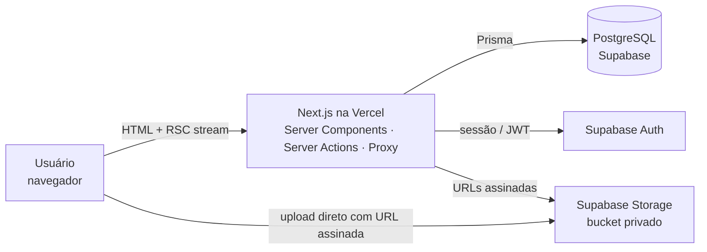
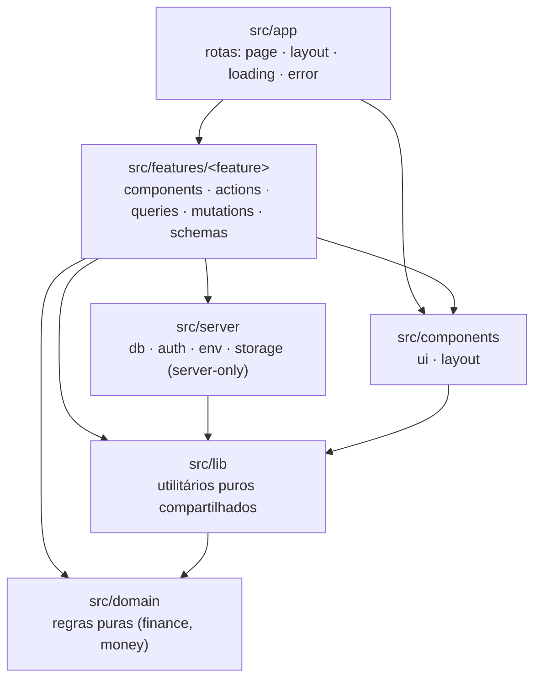
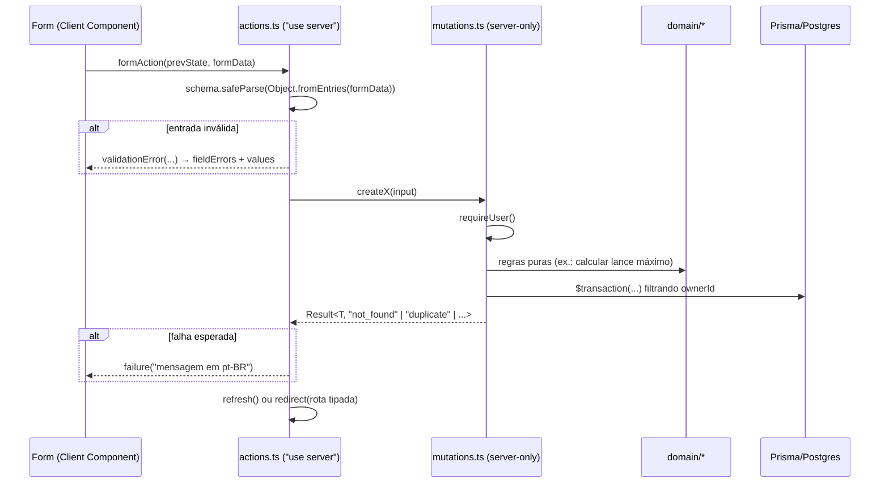

# Leilão Tracker — System Design

> Versão 1.0 • 26/09/2026 • Complementa o [`SPEC.md`](../SPEC.md) (o quê), o [`DESIGN.md`](../DESIGN.md) (visual) e o [`OPERACAO.md`](OPERACAO.md) (deploy, backup e restauração). Este documento define **como** o sistema é construído. Toda decisão estrutural nova entra no [Registro de decisões](#15-registro-de-decisões).
>
> Base técnica: Next.js 16.3 (App Router, Turbopack, Cache Components), React 19.3, TypeScript 6 e a documentação oficial em `node_modules/next/dist/docs/`.

## 1. Princípios

1. **O servidor é a fonte da verdade.** Dados são lidos em Server Components e alterados por Server Actions. Não há API REST própria nem estado global de dados no cliente. A API JSON para consumidores externos já tem contrato definido (§17) e só será implementada quando houver consumidor.
2. **Regras de negócio são código puro.** Cálculo financeiro, elegibilidade e comparação ficam em `src/domain`, sem React, Next ou banco. Por isso são fáceis de testar e rodam tanto no servidor quanto na prévia do navegador.
3. **Segurança perto do dado.** Toda leitura e escrita passa pela Data Access Layer (DAL), que autentica, filtra por `owner_id` e devolve DTOs mínimos. Proxy e UI são só conveniência.
4. **Erros esperados são valores; erros inesperados são exceções.**
5. **Uma forma de fazer cada coisa.** Cada tipo de arquivo tem um padrão, com receita na skill `leilao-padroes`.
6. **Dinheiro em centavos inteiros e datas em UTC.** A conversão para reais e para `America/Sao_Paulo` acontece só na borda (formulário e exibição).

## 2. Contexto



- Uso individual e privado, mas **todo registro tem `owner_id`** desde o início. Isso mantém a autorização explícita e o custo de abrir para mais usuários baixo.
- O navegador nunca fala com o banco. Com o Supabase, fala apenas com Auth (login) e Storage (upload/download por URL assinada).

## 3. Camadas e regra de dependência



As setas indicam "pode importar". Não existe seta no sentido contrário.

| Camada | Responsabilidade | Pode importar | Nunca |
| --- | --- | --- | --- |
| `src/app` | Roteamento e composição da página. Lê `params`/`searchParams`, delega à feature e define `<Suspense>`/boundaries. | features, components, lib | Prisma, regra de negócio, `fetch` direto |
| `src/features/<f>` | Uma fatia do produto: leilões, lotes, análises, resultados, dashboard. | domain, server, components, lib, `@/features/<outra>/queries` | UI, actions ou schemas de outra feature. Para mostrar UI de duas features juntas, a **rota compõe** (ex.: o detalhe do leilão recebe a lista de lotes como slot `lots`). |
| `src/domain` | Regras puras e tipos de domínio (`Cents`, calculadora, elegibilidade). | apenas `src/domain` | React, Next, Prisma, `process.env`, `Date.now()` implícito |
| `src/server` | Infraestrutura server-only: cliente Prisma, sessão, env validado, Storage. | lib, domain | componentes, features |
| `src/components` | Primitivas visuais (`ui`) e casca (`layout`), sem conhecer regras de negócio. | lib, **tipos** de `domain` (ex.: `Money` recebe `Cents`) | features, server, funções de domain |
| `src/lib` | Utilitários puros: `cn`, formatação, `ActionState`, `Result`. | domain (tipos) | server, features |

As fronteiras são **verificadas por ferramenta**:

- `import "server-only"` em todo arquivo de `src/server` e em `queries.ts`/`mutations.ts`. Importá-los no cliente quebra o build.
- ESLint `no-restricted-imports` (`eslint.config.mjs`):
  - Prisma/`@/server/db` só em `src/server/**`, `queries.ts` e `mutations.ts`.
  - `src/domain` não importa framework nem outras camadas.

## 4. Estrutura de pastas

```text
src/
  app/
    layout.tsx                    # raiz: fontes, <html lang="pt-BR">, Providers
    (auth)/login/page.tsx
    (private)/
      layout.tsx                  # casca autenticada (nav); sessão lida dentro de <Suspense>
      dashboard/page.tsx
      leiloes/page.tsx
      leiloes/[id]/page.tsx
      lotes/[id]/page.tsx
      analise/[id]/page.tsx
      error.tsx                   # boundary da área privada
    not-found.tsx
    global-error.tsx
  proxy.ts                        # renovação da sessão Supabase + redirecionamento otimista
  components/
    ui/                           # primitivas (ver DESIGN.md e components/ui/README.md)
    layout/                       # PageHeader, AppShell, navegação
  features/
    auctions/
      components/                 # auction-form.tsx, auction-list.tsx, ...
      actions.ts                  # "use server" — adaptadores finos
      queries.ts                  # server-only — leituras → DTO
      mutations.ts                # server-only — escritas, autorização, transações
      schemas.ts                  # Zod: entrada de formulário (compartilhado cliente/servidor)
      types.ts                    # DTOs expostos à UI
    lots/ analyses/ results/ dashboard/
  domain/
    money.ts                      # Cents, parseBRL, roundCents
    finance/                      # calculadora (SPEC §7), versionada por FORMULA_VERSION
  server/
    db.ts                         # PrismaClient singleton
    auth.ts                       # getCurrentUser / requireUser / signIn / signOut (DAL de sessão)
    supabase.ts                   # cliente Supabase do servidor (cookies)
    env.ts                        # variáveis secretas validadas por Zod
    storage.ts                    # URLs assinadas
  lib/
    utils.ts  format.ts  action-state.ts  result.ts  schemas.ts  public-env.ts
prisma/
  schema.prisma
  migrations/
tests/
  e2e/                            # Playwright (fluxos completos)
  stubs/                          # substitutos para ambiente de teste
```

**Regras de nomes**

- Arquivos e pastas em `kebab-case`. Componentes em `PascalCase`. Funções e variáveis em `camelCase`. Constantes de módulo em `SCREAMING_SNAKE_CASE`.
- Identificadores, tipos e comentários de código em **inglês**. Textos da interface, mensagens de erro ao usuário e documentação em **português do Brasil**.
  - Glossário: leilão = `auction`, lote = `lot`, análise = `analysis`, resultado = `result`, lance = `bid`, comissão = `commission`, margem = `margin`.
- As URLs seguem o português do SPEC (`/leiloes`, `/lotes`, `/analise`), e as pastas de feature usam o inglês.
- Server Actions terminam em `Action` (`createAuctionAction`). O plugin TypeScript do Next só aceita props de função com nome `action` ou terminadas em `Action` em Client Components.
- Schemas Zod terminam em `Schema` (`auctionInputSchema`), com o tipo inferido correspondente (`AuctionInput`).
- DTOs descrevem o uso: `AuctionListItem`, `LotDetail`, `AnalysisSnapshot`.
- **Named exports sempre.** Default export só onde o Next exige (`page`, `layout`, `error`, `proxy` etc.).

## 5. Renderização e cache (Cache Components)

`cacheComponents: true` está ligado. Nesse modelo, tudo é **dinâmico por padrão**: o Next pré-renderiza uma *static shell* e faz streaming das partes que dependem de request ou dados.

Regras do projeto:

1. **Toda leitura de sessão ou de dados fica dentro de um `<Suspense>`**, com fallback de `Skeleton`. Sem isso o dev overlay aponta *blocking route*, e isso é tratado como erro.
2. **O que é estático fica fora do Suspense** (título da página, `PageHeader`, navegação) e entra na shell.
3. **Nada de `await` de sessão no topo de layout.** O layout privado renderiza a casca, e só o componente que mostra o usuário lê a sessão, dentro do próprio `<Suspense>`.
4. **Sem `"use cache"` para dados de domínio no MVP.** Os dados são privados, pequenos e precisam refletir a última escrita (análises e resultados). Cache em memória de servidor serverless traria pouco ganho e risco de dado velho. Se uma leitura cara surgir (ex.: agregados do dashboard), a regra é:
   - `"use cache"` + `cacheLife(...)` + `cacheTag(\`<entidade>:${userId}\`)` numa função **não exportada**, chamada por uma query exportada que resolve o usuário;
   - invalidação com `updateTag` na mutation;
   - registro da decisão aqui.
5. **`params` e `searchParams` são Promises.** Tipar com os helpers globais gerados por `next typegen`: `PageProps<"/lotes/[id]">`, `LayoutProps<...>`, `RouteContext<...>`.
6. **Links tipados** (`typedRoutes`). Rotas dinâmicas não literais usam `as Route`.
7. **Navegação preserva estado** (React `<Activity>`). Dialogs e menus abertos devem fechar ao sair da rota. Ver `02-guides/preserving-ui-state.md`.
8. **React Compiler ligado.** Não escrever `useMemo`, `useCallback` ou `memo` por desempenho.

Exemplo de página:

```tsx
// src/app/(private)/leiloes/page.tsx
export default function AuctionsPage() {
  return (
    <>
      <PageHeader title="Leilões" actions={<NewAuctionButton />} />
      <Suspense fallback={<AuctionListSkeleton />}>
        <AuctionList />   {/* async Server Component: chama listAuctions() */}
      </Suspense>
    </>
  );
}
```

## 6. Autenticação e autorização

| Onde | O que faz | É barreira de segurança? |
| --- | --- | --- |
| `src/proxy.ts` | Renova a sessão Supabase com `getClaims()` (padrão oficial `@supabase/ssr`). Redireciona para `/login?next=<rota>` quem não tem sessão e para `/dashboard` quem já está logado em `/login`, preservando os cookies renovados no redirect. Não acessa o banco. | Não (otimista) |
| `src/server/auth.ts` | `getCurrentUser()` valida o JWT com `supabase.auth.getClaims()` (assinatura verificada; **nunca** `getSession()` no servidor), com memo por request via `React.cache`. `requireUser()` redireciona para `/login` quando não há usuário. Login e logout também ficam aqui e retornam `Result`. | **Sim** |
| `queries.ts` / `mutations.ts` | Chamam `requireUser()` e filtram **toda** consulta por `ownerId: user.id`. | **Sim** |
| `actions.ts` | Delegam à mutation, que já autentica. Nunca confiam em ids de dono vindos do cliente. | Via mutation |
| Layouts | Não fazem checagem de auth, porque não re-renderizam em toda navegação. | Não |

- O cliente envia **referências** (ids) e a mudança desejada. Dono, status e valores derivados são relidos do banco pela sessão.
- Registro de outro dono é tratado como "não encontrado", sem revelar que ele existe. Na leitura, a query devolve `null` e o componente chama `notFound()`. Na escrita, a mutation devolve `err("not_found")`.
- DTOs só contêm o que a tela usa. Nunca repassar o objeto do Prisma para um Client Component.

## 7. Leitura de dados

```text
page.tsx ──► <Suspense> ──► Async Server Component (feature/components)
                                  │
                                  ▼
                        queries.ts  (import "server-only")
                          1. const user = await requireUser()
                          2. prisma.<model>.findMany({ where: { ownerId: user.id, ... }, select: {...} })
                          3. return row ? toDTO(row) : null   ← tipos em types.ts
```

- `select` explícito em toda consulta, sem `include` genérico.
- Buscas independentes em paralelo com `Promise.all`, sem waterfall.
- Client Components recebem dados por props, já serializáveis: `Date` ou string ISO, e centavos como `number`.
- Leitura de filtros: `searchParams` validado por um schema Zod em `schemas.ts` (valores inválidos caem no padrão, sem lançar erro).

## 8. Mutações



Contratos:

- **Assinatura da action de formulário:** `(prev: ActionState, formData: FormData) => Promise<ActionState>`. O formulário usa `useActionState(action, idleState)`.
- **Ações sem formulário** (arquivar, fixar) recebem ids por `.bind(null, id)` e seguem o mesmo retorno.
- **Mutations retornam `Result`** (`src/lib/result.ts`) para falhas de negócio (`"not_found"`, `"duplicate_lot_number"`, `"analysis_already_fixed"`). Erros inesperados são lançados.
- **Depois de escrever:** `redirect()` quando a tela muda (criação → detalhe) ou `refresh()` quando fica na mesma rota. Se no futuro houver `"use cache"` com tag, usar `updateTag(tag)` antes.
- **`redirect()` fica fora de `try/catch`**, porque ele lança por design.
- **Operações compostas** (fixar análise, revisar resultado) acontecem numa `prisma.$transaction`. Unicidade (`auction_id, lot_number`) e (`lot_id, revision`) é garantida pelo banco, e o erro `P2002` vira `err("duplicate_...")` na mutation.
- **Retorno mínimo:** nunca devolver registro do banco para o cliente.

## 9. Validação

- **Schemas Zod ficam em `features/<f>/schemas.ts`** e são a única definição da forma da entrada. O cliente pode usá-los para feedback imediato, e o servidor **sempre** revalida.
- **Conversões de borda acontecem no schema:**
  - texto em reais → `Cents` com `parseBRL`;
  - `""` → `undefined` nos campos opcionais;
  - datas locais → `Date` UTC;
  - `trim` em textos.
- **Mensagens de erro em pt-BR** no próprio schema.
- **`searchParams`, `params` e `FormData` são sempre `unknown`** até passarem por um schema.
- **O banco também valida.** Constraints `NOT NULL`, `CHECK` (valores ≥ 0) e `UNIQUE` duplicam as regras críticas.

## 10. Tratamento de erros

| Situação | Mecanismo | UI |
| --- | --- | --- |
| Campo inválido | `validationError()` → `ActionState` | Erro no campo (`fieldError`) e valor preservado (`fieldValue`) |
| Regra de negócio / conflito | `Result` na mutation → `failure()` | `Alert` no formulário ou `toast` |
| Registro inexistente, de outro dono ou id inválido | query devolve `null` → componente chama `notFound()` | `not-found.tsx` |
| Sessão ausente | `requireUser()` → `redirect("/login")` | Login |
| Bug / falha de infraestrutura | exceção | `error.tsx` do segmento (prop `retry`), `catchError` para trechos isolados, `global-error.tsx` |
| Erro em event handler do cliente | `try/catch` local + estado | `toast` |

Mensagens técnicas (stack, SQL) nunca chegam ao usuário. O `error.tsx` mostra texto genérico e `digest`, e registra o erro com `console.error`.

## 11. Domínio financeiro

- `src/domain/finance/calculator.ts` implementa o SPEC §7 com `Cents` e `Bps`, sem `Date.now()` ou I/O:
  - `calculateMaxBid(inputs)` devolve `{ kind: "viable", maxBid, … } | { kind: "not_viable" } | { kind: "incomplete", missing }`. Ausência (`null`) nunca vira zero.
  - `simulateBid(complete, bid)` calcula comissão, custos fora do lance, custo total e margem estimada.
  - `compareToLimit(outcome, bid)` classifica em `below_limit | at_limit | above_limit | no_viable_bid | unavailable` (§7.5). Os rótulos em pt-BR ficam na feature.
- **Lance máximo exato ao centavo:** parte da divisão teórica e ajusta depois de arredondar a comissão, até o maior lance que satisfaz `custo total + M ≤ V`. Um teste com 1.000 entradas geradas confirma que o lance máximo cabe e que o centavo seguinte não cabe.
- **Comissão percentual** por `applyRate`, com aritmética inteira e arredondamento half-up, sem ponto flutuante no produto.
- **`FORMULA_VERSION` é exportada** e persistida junto das saídas fixadas (`analyses.formula_version`). Mudança de fórmula exige nova versão e nunca recalcula análises históricas.
- A **prévia** (Client Component) importa a mesma função que a mutation usa para fixar a análise. Na fixação, o servidor recalcula a partir das entradas e ignora saídas vindas do cliente.
- **Percentuais em basis points inteiros** (`commission_rate_bps`), sem ponto flutuante persistido.
- **A cobertura de testes do domínio é obrigatória:** exemplos do SPEC §7.3/7.4, bordas de arredondamento, "sem lance viável" e entradas incompletas.

## 12. Persistência

- **Prisma 7** (gerador `prisma-client`, sem engine Rust) acessa o PostgreSQL do Supabase. O cliente é gerado em `src/generated/prisma` (fora do Git, gerado no `postinstall`) e instanciado uma vez em `src/server/db.ts` com `@prisma/adapter-pg`, com singleton em dev para o HMR.
- **Duas conexões:** a aplicação usa `DATABASE_URL` (pooler de transação, porta 6543, `pgbouncer=true`). A CLI usa `DIRECT_URL` (pooler de sessão, porta 5432), configurada em `prisma.config.ts`. O Prisma 7 não tem mais `url`/`directUrl` no `schema.prisma`.
- **`prisma.config.ts` carrega `.env*` com `@next/env`**, o mesmo carregador do Next, então não há `dotenv` nem arquivo `.env` separado para o Prisma.
- **Migrations versionadas em `prisma/migrations`**, criadas com `prisma migrate dev` e aplicadas em produção com `prisma migrate deploy`. Nunca editar migration já aplicada.
- **Convenções de schema:**
  - tabelas e colunas em `snake_case` (`@@map`/`@map`), modelos em `PascalCase`;
  - ids `uuid`;
  - `created_at`/`updated_at` gerados pelo banco e datas em `timestamptz`;
  - valores monetários em `integer` de centavos, até R$ 21.474.836,47 (D-15);
  - arquivamento lógico por `archived_at`.
- **Data API do Supabase fechada (D-14):** toda tabela nasce com `ENABLE ROW LEVEL SECURITY` **sem políticas** e com `REVOKE ALL ... FROM anon, authenticated`, no SQL da própria migration. A chave publicável do navegador não lê nem escreve nada. O Prisma conecta como `postgres`, que ignora RLS, e a autorização fica na DAL.
- **Imutabilidade:** análises `fixed` e revisões de resultado nunca recebem `UPDATE` nem `DELETE` nas mutations. Correção = nova revisão (SPEC RF-05/RF-06).
- **Índices** conforme SPEC §8, declarados no `schema.prisma` (índices parciais com o preview `partialIndexes`).
- **SQL fora do Prisma:** CHECKs, triggers e RLS são escritos à mão na migration, criada com `prisma migrate dev --create-only`. Depois de aplicar, `prisma migrate diff --from-config-datasource --to-schema prisma/schema.prisma --exit-code` deve sair com 0 (sem drift).

## 13. Arquivos (fotos)

- **Bucket privado.** O upload vai **direto do navegador para o Storage** com uma URL assinada de upload criada por Server Action. Isso evita o limite de 1 MB de body das actions.
- **A action valida antes de emitir a URL:** dono do lote, tipo MIME (`image/jpeg|png|webp`) e tamanho. Depois do upload, outra action registra `lot_images`.
- **Exibição por URL assinada de curta duração** (1 h), gerada no servidor.
- **Bucket `lot-images` privado**, com limite de 5 MB e JPEG/PNG/WebP no próprio Storage, e políticas `SELECT`/`INSERT`/`DELETE` restritas à pasta `<owner_id>/…`. Sem `UPDATE`: arquivo não é sobrescrito. Configuração em `prisma/sql/storage.sql` (D-20).
- **Ordem das operações:** registro no banco só depois de conferir o arquivo, e remoção do arquivo só depois de apagar o registro. Uma falha do Storage deixa, no pior caso, um arquivo órfão, nunca uma foto registrada que não abre (SPEC §11).

## 14. Configuração, qualidade e testes

**Ambiente**

- `src/server/env.ts` (server-only) valida as variáveis **secretas** com Zod na primeira importação. `src/lib/public-env.ts` valida as **públicas** (`NEXT_PUBLIC_*`, lidas pelo nome literal para o Next embutir no bundle), usadas pelo proxy e pelos clientes Supabase. Nenhum outro arquivo lê `process.env`.
- `.env.example` lista todas as variáveis, e `.env*` é ignorado pelo Git.

**Ferramentas e scripts**

| Comando | Uso |
| --- | --- |
| `npm run dev` | Desenvolvimento (Turbopack) |
| `npm run check` | typecheck + lint + format:check + test. **Obrigatório antes de concluir qualquer tarefa.** |
| `npm run build` | Build de produção. Obrigatório ao mexer em rotas, config ou fronteira server/client. |
| `npm run format` / `lint:fix` | Correções automáticas |
| `npm run db:migrate` / `db:storage` | Migrations do Prisma (+ `generate`) / bucket e políticas do Storage |
| `npm test` / `test:watch` | Vitest |

- **TypeScript estrito**, com `noUncheckedIndexedAccess`, `noImplicitReturns`, `noImplicitOverride` e `noFallthroughCasesInSwitch`.
- **ESLint** com as regras do Next e `typescript-eslint` com informação de tipos:
  - `no-floating-promises`, `no-misused-promises`, `switch-exhaustiveness-check`, `consistent-type-imports`;
  - sem `any` e sem `!`;
  - imports ordenados;
  - fronteiras de camada.
- **Prettier** (largura 120, classes Tailwind ordenadas) é a única fonte de formatação.

**Pirâmide de testes**

| Nível | Ferramenta | Alvo | Local |
| --- | --- | --- | --- |
| Unitário | Vitest | `domain`, `lib`, schemas, componentes síncronos | `*.test.ts(x)` ao lado do arquivo |
| Integração | Vitest + banco de teste | `mutations`/`queries` (unicidade, versões, autorização) | `*.int.test.ts` (quando o banco existir) |
| E2E | Playwright + `@next/playwright` | Fluxo SPEC §13, critérios de aceite de interface e casca estática (`instant()`) | `tests/e2e` (`npm run test:e2e`; usuário de testes dedicado) |

## 15. Registro de decisões

| # | Decisão | Motivo | Alternativa descartada |
| --- | --- | --- | --- |
| D-01 | `cacheComponents: true` desde o início | É o modelo atual do Next 16, com shell estática, streaming e validação de navegação instantânea. Migrar depois custa mais. | Modelo anterior (`dynamic`, `revalidate`) |
| D-02 | DAL por feature (`queries.ts`/`mutations.ts`) + `server/auth.ts` | Abordagem recomendada pelo Next para projetos novos: autorização centralizada e DTOs. | Consultas diretas em componentes |
| D-03 | Formulários com `useActionState` + Zod + `ActionState` | Padrão da documentação do Next e do React 19: progressive enhancement, sem estado duplicado. **Substitui React Hook Form do SPEC §9.** | React Hook Form |
| D-04 | Sem `"use cache"` para dados de domínio no MVP | Dados privados, poucos e sensíveis à última escrita | Cache por usuário com tags |
| D-05 | Dinheiro como `Cents` (inteiro com marca de tipo) | Elimina erros de ponto flutuante e confusão entre reais e centavos | `number` livre / `Decimal` |
| D-06 | React Compiler ligado | Memoização automática, estável no Next 16 | `useMemo`/`useCallback` manuais |
| D-07 | `typedRoutes` ligado | Links quebrados viram erro de compilação | Strings livres |
| D-08 | Vitest, com testes junto do código | Recomendado pelo Next. Substitui o runner `node --test` com transpilação manual. | Jest |
| D-09 | Prettier + `eslint-config-prettier` + `simple-import-sort` | Formatação sem debate. O `import/order` do plugin do Next não carrega o resolver TS nesta versão. | Formatação manual |
| D-10 | Código em inglês, interface e docs em pt-BR | Consistência com bibliotecas e glossário único | Misturar idiomas |
| D-11 | Upload direto ao Storage por URL assinada | Evita o limite de body das Server Actions e não passa arquivo pelo servidor | Upload via action/Route Handler |
| D-12 | Proxy só otimista; autorização real na DAL | Recomendação oficial: proxy roda em toda rota e prefetch | Checar banco no proxy |
| D-13 | Prisma 7.10.0 fixo, com adapter `pg` e env via `@next/env` | Última versão estável (a tag `latest` do pacote `prisma` aponta para 8.0 RC). O adapter é obrigatório no Prisma 7. | Snippet do Supabase (`prisma-client-js`, `directUrl`), Prisma 8 RC, `dotenv` |
| D-14 | RLS ligado sem políticas + `REVOKE` para `anon`/`authenticated` em todas as tabelas | O schema `public` é exposto pela Data API e a chave publicável é pública. Assim o único caminho até os dados é o servidor. | Políticas RLS por usuário (duplicariam a DAL) ou schema privado |
| D-15 | Centavos em `integer` (int4), não `bigint` | O teto de R$ 21 milhões por valor cobre veículos com folga, e o Prisma mapeia `Int` para `number`, compatível com `Cents`. `BigInt` viraria `bigint` no JS e exigiria conversão em toda leitura. | `bigint` / `Decimal` |
| D-16 | Integridade no banco: FKs compostas `(id, owner_id)`, índices únicos parciais, CHECKs e triggers de imutabilidade | O SPEC §8 exige relações do mesmo dono, um rascunho por lote e análises e resultados imutáveis. O banco garante isso mesmo se a aplicação falhar. CHECKs, triggers e RLS ficam no SQL da migration, porque o Prisma não os modela. | Validar só na aplicação |
| D-17 | Sem API JSON própria no MVP; contrato da futura API definido em §17 | A tela usa a DAL direto (recomendação do Next). A separação está no código (`domain` e DAL devolvem DTOs serializáveis), então a API vira um adaptador fino quando houver consumidor externo. | API JSON consumida pela própria tela; backend separado |
| D-18 | Supabase Auth com `@supabase/ssr` 0.12 + `getClaims()`, Node ≥ 22 | Padrão do guia oficial de Next.js (o SDK `@supabase/server` é genérico). `getClaims()` verifica a assinatura do JWT localmente com chaves assimétricas. As bibliotecas Supabase JS deixaram de suportar Node 20 em 30/06/2026. | `getSession()` no servidor; `getUser()` em toda requisição; `@supabase/server` |
| D-19 | Coluna `results.prior_declared` e temporalidade calculada no servidor a cada revisão | O SPEC §10 pede registrar a confirmação declarada quando o horário do desfecho é desconhecido, e o modelo do §8 não tinha onde. A regra (`classifyAnalysisTiming`) fica no domínio e é gravada em `analysis_timing` na própria revisão, nunca vinda do cliente. | Guardar a declaração em texto livre; recalcular a temporalidade na leitura |
| D-20 | Bucket e políticas do Storage em `prisma/sql/storage.sql` (idempotente, `npm run db:storage`); upload em 3 passos com conferência do arquivo real | O schema `storage` é do Supabase e não existe no shadow database do Prisma, então não pode ir em migration. O servidor autoriza e emite a URL, o navegador envia direto, e o servidor confere tamanho, tipo e assinatura binária antes de registrar. Arquivo inválido é removido. | Migration do Prisma; confiar no tipo declarado pelo navegador |
| D-21 | CSP sem nonce + cabeçalhos de segurança em `next.config.ts`; `robots.txt` e `noindex` | Nonce exige renderização dinâmica e é incompatível com o Partial Prerendering (guia de CSP do Next). A política restringe origens (própria e Supabase), bloqueia `object`, `frame-ancestors` e formulários externos. | CSP com nonce; SRI (experimental) |
| D-22 | Backup e restauração por scripts Node (`npm run backup`/`restore`), com simulação por padrão, destino explícito e vazio, transação única e `--owner` para projeto novo | Sem `pg_dump` local, e o Supabase Free não oferece download de backups. O formato JSON é validado contra as mesmas garantias do banco; ensaio com dados sintéticos restaurou conteúdo idêntico. | `pg_dump` (dependência externa); backups do plano Supabase |
| D-23 | Automação do Claude Code versionada em `.claude/`: hooks em Node (`protect-files.mjs` bloqueia `.env*`, `backups/`, arquivos gerados e migrations versionadas; `format-file.mjs` roda `eslint --fix` + Prettier no arquivo editado), permissões (`allow` para verificações, `ask` para comandos que tocam o banco, `deny` de leitura de `.env`/`.env.local`/`backups/`), subagente `leilao-reviewer` e MCP do Supabase em `.mcp.json` **somente leitura** | O agente segue as regras sem depender de memória, e comandos destrutivos pedem confirmação. Hooks em Node rodam igual no Windows e no CI, sem `jq`. O MCP é só para diagnóstico: schema continua só por migrations do Prisma. | Git hooks (husky); hooks em bash com `jq`; MCP com escrita |

## 16. Pendências da fundação

1. Inicializar o repositório Git e fazer o primeiro commit.
2. ~~Criar o projeto Supabase e preencher `.env.local`~~ (feito; conexões testadas).
3. ~~Prisma, `src/server/env.ts`, `src/server/db.ts`, modelos e migration inicial~~ (feito).
4. ~~Autenticação: `src/server/{supabase,auth}.ts`, `src/proxy.ts`, `/login`, casca `(private)` e dashboard com contagens~~ (feito; a vitrine de componentes foi para `/componentes`). Falta: `src/server/storage.ts` (junto com as fotos).
5. ~~Configurar Playwright para o fluxo E2E~~ (feito: `public` roda sem sessão; `authenticated` precisa de `E2E_EMAIL`/`E2E_PASSWORD`).

**Features entregues:** autenticação, leilões (RF-01), lotes (RF-02/03), análise financeira (RF-04/05), resultados com correções e temporalidade (RF-06, §10), dashboard completo (métricas, indicador, pendências, lotes acompanhados, próximos leilões) e arquivamento (RF-08). fotos (RF-07). E2E, preparação para deploy (runbook em `docs/OPERACAO.md`). **Próximo:** primeiro deploy na Vercel.

## 17. Contrato da API JSON (futuro)

> **Status:** definido, **não implementado** (D-17). Implementar só quando houver um consumidor fora da tela: app mobile, script, integração ou automação. Mudanças neste contrato entram no registro de decisões.

### Princípios

- **Adaptador fino.** Cada rota faz parse da entrada com o schema Zod da feature, chama `queries.ts`/`mutations.ts`, converte `Result` em resposta HTTP e devolve o DTO de `types.ts`. Não há regra de negócio nem acesso ao Prisma na rota.
- **Mesmas garantias da tela.** A rota usa o mesmo `requireUser()`, o mesmo filtro por `ownerId` e as mesmas validações. A API não é caminho alternativo com menos regras.
- **A tela não consome a API.** Ela usa a DAL direto, porque buscar a própria API cria volta HTTP extra (guia *Backend for Frontend*, seção *Caveats*).

### Localização e recursos

- Rotas em `src/app/api/v1/<recurso>/route.ts` e `src/app/api/v1/<recurso>/[id]/route.ts`.
- Recursos no plural, em inglês e kebab-case, igual aos identificadores de código: `/api/v1/auctions`, `/api/v1/lots`, `/api/v1/lots/{id}/analyses`, `/api/v1/lots/{id}/results`, `/api/v1/lots/{id}/images`.

| Método | Uso | Sucesso |
| --- | --- | --- |
| `GET /recurso` | Lista paginada | `200` |
| `GET /recurso/{id}` | Detalhe | `200` |
| `POST /recurso` | Criação | `201` + cabeçalho `Location` |
| `PATCH /recurso/{id}` | Atualização parcial | `200` |
| `DELETE /recurso/{id}` | Exclusão, só quando o RF-08 permite | `204` |
| `POST /recurso/{id}/<acao>` | Ação de domínio, ex.: `POST /lots/{id}/analyses/{analysisId}/fix`, `POST /auctions/{id}/archive` | `200` |

- **Resultados só recebem `POST`.** Cada chamada cria uma nova revisão (correção). Não há `PATCH`, `PUT` ou `DELETE` em resultado nem em análise fixada, igual ao banco (D-16).

### Formato das respostas

```jsonc
// Sucesso (item)
{ "data": { "id": "0199…", "name": "Leilão Detran SP", "startsAt": "2026-10-02T13:00:00.000Z" } }

// Sucesso (lista)
{ "data": [ { … } ], "meta": { "page": 1, "pageSize": 25, "total": 142 } }

// Erro
{ "error": { "code": "validation_failed", "message": "Revise os campos destacados.", "fields": { "name": ["Informe o nome do leilão."] } } }
```

- Sempre `Content-Type: application/json; charset=utf-8`. Nunca devolver array ou valor solto na raiz.
- **`code`** é estável, em `snake_case` e em inglês, para máquinas. **`message`** fica em pt-BR, para pessoas. **`fields`** só aparece em `validation_failed`.
- **Os códigos de negócio são os mesmos** das uniões de erro das mutations (`Result`). Um código novo na mutation é um código novo na API.

### Códigos HTTP

| Status | `code` | Quando |
| --- | --- | --- |
| `400` | `invalid_request` | JSON malformado, `Content-Type` errado, parâmetro de URL inválido |
| `401` | `unauthenticated` | Sem token ou token inválido/expirado |
| `404` | `not_found` | Não existe **ou é de outro dono** (nunca `403`, para não revelar existência) |
| `405` | `method_not_allowed` | Método não suportado pela rota |
| `409` | `duplicate_lot_number`, `analysis_already_fixed`, `draft_already_exists`… | Conflito com regra de negócio |
| `413` | `payload_too_large` | Corpo acima do limite |
| `422` | `validation_failed` | Entrada bem formada, mas inválida pelo schema Zod |
| `429` | `rate_limited` | Limite de requisições atingido (com `Retry-After`) |
| `500` | `internal_error` | Falha inesperada. Mensagem genérica, sem stack nem SQL; o detalhe só vai para o log. |

### Serialização (igual aos DTOs)

- Campos em `camelCase`. Ausência de valor é `null` explícito; campos não são omitidos.
- **Dinheiro** em centavos inteiros com sufixo `Cents` (`maxBidCents: 3320000`). A API nunca devolve reais formatados nem número decimal.
- **Percentuais** em pontos-base inteiros com sufixo `Bps` (`commissionRateBps: 500`).
- **Data e hora** em ISO 8601 UTC com `Z` (`2026-10-02T13:00:00.000Z`). **Datas sem hora** em `YYYY-MM-DD`. O fuso de exibição é responsabilidade do cliente.
- **Ids** em UUID (texto). **Enums** com os valores do banco (`"sold"`, `"bid_not_won"`).

### Listas

- **Paginação:** `?page=1&pageSize=25` (padrão 25, máximo 100).
- **Ordenação:** `?sort=startsAt:asc` (campos permitidos definidos por recurso).
- **Filtros** por query string, validados pelo schema de filtros da feature. Valor inválido gera `400`, diferente da tela, onde vira o padrão.

### Autenticação e segurança

- **Autenticação:** `Authorization: Bearer <access token do Supabase Auth>`. A API **não aceita cookie de sessão**, o que elimina CSRF. `requireUser()` passa a resolver o usuário pelo token quando a rota for de API.
- **CORS** fechado por padrão, com lista explícita de origens apenas se houver cliente web externo.
- **Escrita** exige `Content-Type: application/json`, com limite de corpo por rota. Upload de foto continua por URL assinada (D-11), nunca pelo corpo da API.
- **Rate limit** por usuário nas rotas de escrita.
- **Idempotência:** `POST` aceita `Idempotency-Key`, a avaliar quando existir cliente com retentativa automática.
- **Logs** sem corpo de requisição, token ou dado pessoal.

### Versionamento e documentação

- **Prefixo `/api/v1`.** Adicionar campo ou rota não quebra o contrato. Remover ou renomear campo, mudar tipo ou semântica exige `/api/v2`, com a `v1` mantida durante a transição.
- **Especificação OpenAPI gerada dos schemas Zod** (`z.toJSONSchema`) e dos tipos de `types.ts`, publicada junto da API. Não é mantida à mão.
- **Testes de contrato** por rota: status, envelope, códigos de erro e isolamento por dono (usuário A não acessa dado de B).
